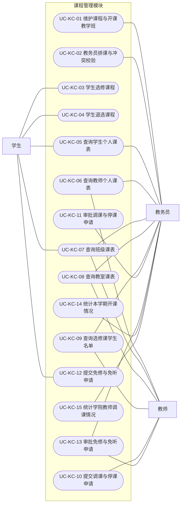
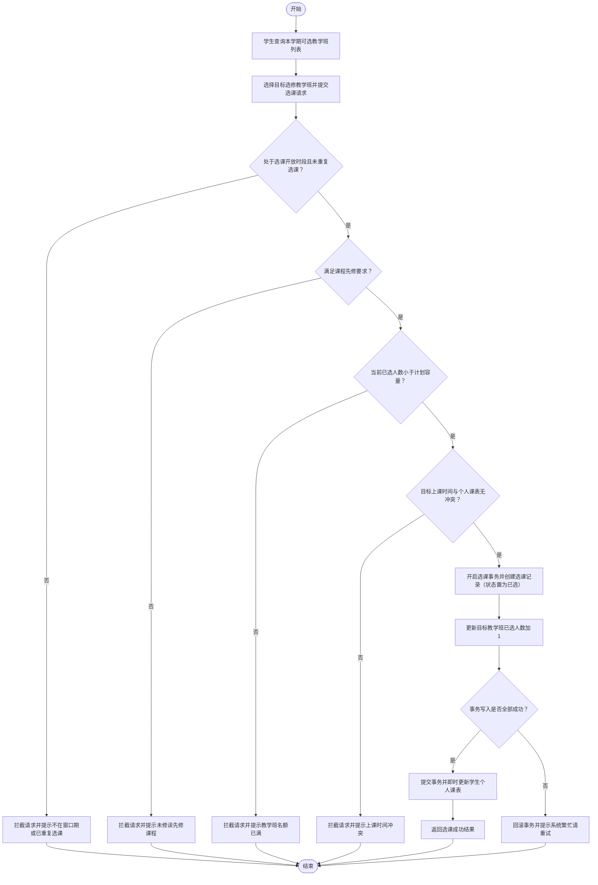
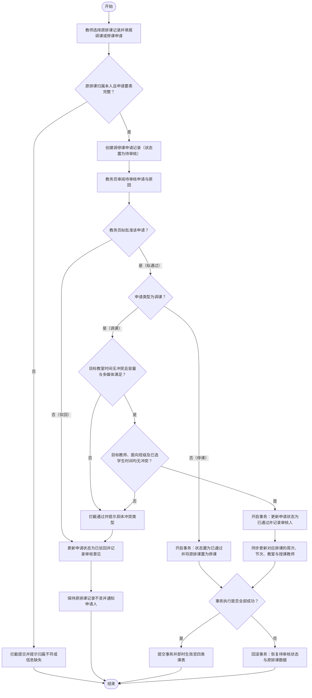
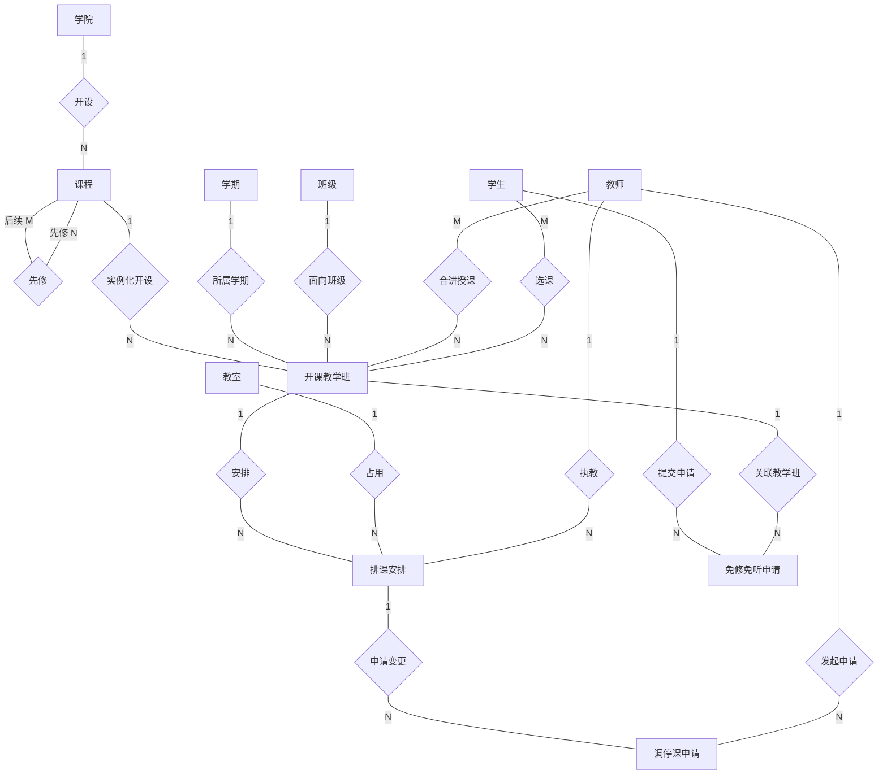

# 教务系统数据库需求分析文档（A 组长独立稿：公共基准与课程管理模块）

> **所属课程**：数据库系统原理课程设计  
> **负责成员**：成员 A（组长）  
> **交付范围**：引言与系统边界、全组公共实体契约、系统角色与核心业务划分、课程管理模块完整需求分析（用例图、简化版用例说明、核心业务流程图、概念 E-R 子图）、系统非功能需求分析（选做加分项）。  
> **合稿说明**：本文档按小组统一规范编写，可直接由成员 E 汇总并合入全组《需求分析文档》终稿。

---

## 1. 引言与系统边界

### 1.1 编写目的与课程约定

本阶段旨在全面、准确地梳理高校教务管理的核心业务场景、数据对象、操作流程与质量约束，为后续逻辑结构设计、物理结构设计及测试优化提供清晰依据。依照课程约定，本项目基于关系型数据库 MySQL 8，**仅聚焦与数据库相关的需求分析、结构设计、数据构建、业务测试与性能优化，不涉及前端界面与后端应用服务开发**。

成员 A 在阶段 1 承担两项核心任务：其一，锁定全组通用的系统边界、角色权限框架、公共业务实体基准与非功能质量指标，保障 5 名成员并行推进且无合并冲突；其二，独立完成**课程管理模块**的全部功能需求、核心业务流程及概念结构设计。

### 1.2 系统业务边界与内外数据界定

高校教务运行涉及校内多个行政与支撑部门。为避免数据库职责无限扩张，需明确划分本系统边界内与边界外的数据归属（表 1-1）。

**表 1-1 教务系统边界内外数据界定及对数据库设计的影响**

| 数据类别 | 涉及范围 | 数据来源与归属 | 对后续数据库设计的影响 |
| :--- | :--- | :--- | :--- |
| **边界内核心数据** | 学院、专业、班级、学生、教师、学期、教室等基础主数据；课程、成绩、考试、教室借用、毕设、评教、学籍、师资 8 大模块业务数据 | 完全由本系统内部产生与维护，同时向校内其他部门提供教学运行数据支撑 | 必须设计完整、规范的数据结构、完整性约束与状态流转记录，确保全生命周期数据准确一致 |
| **边界外依赖数据：人事系统** | 教师入职编制、薪酬社保、人事档案变动 | 归属学校人事部门，教务系统仅消费教师工号、姓名、职称、年龄、所属学院等教学相关属性 | 不在本库维护薪资与人事明细，仅保存同步后的教师基础信息镜像，通过工号与外部保持关联 |
| **边界外依赖数据：招生与财务系统** | 新生录取档案、学费缴纳明细、校园一卡通消费与门禁 | 归属招生办与财务处，教务系统仅按学号接收报到注册后的学籍有效状态 | 不存储财务流水与招生原始档案；选课、学籍异动仅校验学籍状态，预留外部对接标识 |
| **边界外依赖数据：统一身份认证（SSO）** | 校园网门户账号、统一口令策略与单点登录会话 | 归属信息化中心，负责用户身份认证 | 数据库不承担全校账号认证中心职责，仅设计面向教务业务的基于角色访问控制模型与角色视图 |
| **边界外依赖数据：教室物联网/中控** | 教室门禁开关、投影与音响硬件控制指令 | 归属后勤与电教设备平台 | 本系统仅维护教室容量、是否支持多媒体与排课/借用占用状态，不介入底层设备控制 |

---

## 2. 全组公共实体契约（基准约定）

为避免各成员对同一业务概念使用不同命名或拆分粒度导致全局 E-R 图无法拼合，全组在需求分析与数据库设计阶段统一遵循以下 **9 个公共业务实体** 与 **统一时间口径**。

### 2.1 全组统一公共业务实体清单

**表 2-1 全组 9 个公共业务实体契约**

| 序号 | 统一实体名称 | 业务定义 | 核心业务属性约定（面向全组跨模块支撑） | 主要引用模块 |
| :---: | :--- | :--- | :--- | :--- |
| 1 | **学院** | 学校二级教学与行政单位 | 学院编号、学院名称 | 全部模块 |
| 2 | **专业** | 学院下设的学科培养方向 | 专业编号、专业名称、所属学院、学制 | 学籍、课程、成绩、毕设 |
| 3 | **班级** | 学生所属的自然行政班 | 班级编号、班级名称、所属专业、入学年级 | 学籍、课程、成绩、考试 |
| 4 | **学生** | 在校受教育者个体 | 学号、姓名、性别、所属班级、所属专业、所属学院、**年级**、**毕业年级/毕业状态**、**学籍状态**（在读/休学/退学/毕业/肄业）、**家庭情况** | 全部模块 |
| 5 | **教师** | 承担授课、监考与毕设指导的教学人员 | 工号、姓名、性别、所属学院、**职称**（助教/讲师/副教授/教授）、**年龄（及出生日期）**、在职状态 | 全部模块 |
| 6 | **学期** | 教学活动开展的标准时间周期 | 学期编号、学年、学期名称（如 2025-2026 春）、开始日期、结束日期、当前学期标志 | 课程、成绩、考试、评教、毕设 |
| 7 | **教室** | 开展课堂教学、考试与借用活动的物理场地 | 教室编号、教学楼、房间号、**容纳人数（容量）**、**是否支持多媒体**、教室类型、可用状态 | 课程、考试、教室 |
| 8 | **课程** | 培养方案中的抽象课程定义（跨学期复用） | 课程编号、课程名称、**课程性质**（必修/专业选修/公共选修/实践）、**学分**、总学时、开课学院、**先修课程** | 课程、成绩 |
| 9 | **开课教学班** | 某学期开设的某门课程的具体授课实例（严格区分“抽象课程”与“具体开课”） | 教学班编号、所属课程、所属学期、面向行政班级（必修课指定，选修课可不限）、计划容量、当前已选人数、是否要求多媒体教室、开课状态 | 课程、成绩、考试、评教 |

**跨模块关键基准说明**：

1. **多教师合讲约定**：评教模块要求支持“学生为某学期参加过的某门课程的所有教师评分”，且高校实际教学中常由多位教师联合讲授同一教学班。因此，**`开课教学班` 与 `教师` 之间定义为多对多（M:N）授课联系**，允许一个教学班关联多名授课教师，同时一名教师可在同学期承担多个教学班教学任务。
2. **跨模块预留属性约定**：`学生` 预留年级、毕业状态、学籍状态与家庭情况，`课程` 明确课程性质与学分，用于直接支撑成绩模块“毕业年级学生专业选修课学分总数统计”及学籍模块“学生人数与家庭情况统计”；`教师` 预留职称与年龄，直接支撑教师模块师资结构统计；`教室` 明确容纳人数与是否支持多媒体，直接支撑排课与排考场地校验。
3. **单向依赖原则**：上述 9 个公共业务实体由成员 A 统一定义与维护，成绩（B）、考试与教室借用（C）、毕设与评教（D）、学籍与师资（E）模块仅通过公共实体建立关联，不更改公共实体的既有语义与核心属性。

### 2.2 全组统一时间表示口径

课程管理（排课、调课、停课）、考试管理（排考与冲突检查）与教室管理（教室借用、某周空闲时间查询）均高度依赖时间冲突判定。全组统一采用四维结构化时间口径：

> **统一时间口径** = **`学期`** + **`周次`**（起始周到结束周，配合单双周标志：全周 / 单周 / 双周）+ **`星期`**（星期一到星期日）+ **`节次`**（起始节次到结束节次，如第 1–2 节、第 3–4 节）

两条教学或借用安排在同一学期内构成**时间冲突**，当且仅当三项条件同时成立：周次区间存在公共上课周（且单双周规则相交）、星期几相同、节次区间存在重叠。统一口径后，跨模块场地与人员冲突校验具备一致的判定标准。

---

## 3. 系统参与角色与核心/非核心业务划分

### 3.1 参与角色职责与数据访问权限差异

教务系统面向**教务员**、**教师**与**学生**三类核心角色运行。三类角色在业务职责与数据可见范围上存在严格边界（表 3-1）。

**表 3-1 系统参与角色职责与数据权限矩阵**

| 参与角色 | 核心业务职责 | 数据查询范围 | 数据写入与审批权限 |
| :--- | :--- | :--- | :--- |
| **教务员** | 维护学院/专业/班级/课程等基础目录；制定学期开课计划与排课；审批调/停课、免修/免听、缓考、学籍异动等申请；执行全校或学院级教学统计 | 全校或所辖学院全部课程、排课、选课、审批、课表及统计数据 | 拥有基础目录与排课数据的增删改权限、各类教学审批的终审权限 |
| **教师** | 查询本人课表与公共课表；查询本人所授选修课学生名单；提交调课/停课申请；对学生免修/免听申请执行初审 | 仅限本人任教教学班的课表与选课学生名单、本人提交的调/停课申请及待本人初审的免听申请；可查阅公开的班级/教室课表 | 仅可发起本人授课记录的调/停课申请及录入本人初审意见，严禁直接篡改排课计划或查看非本人授课学生隐私 |
| **学生** | 查询可选课程与个人/班级课表；在规定选课窗口内选修或退选课程；提交免修/免听申请并跟踪审批结果 | 公开的可选教学班目录与余量信息、本人选课记录、本人个人课表、所属班级课表及本人提交的免修/免听申请 | 仅可在开放时段内维护本人的选课/退课记录与免修/免听申请，严禁查看他人选课明细或修改任何排课数据 |

**对数据库设计的影响**：不同角色的数据可见范围差异显著，后续数据库设计需引入基于角色的访问控制策略（RBAC），并在数据库层面针对教务员、教师、学生分别构建权限隔离视图，确保权限控制不单纯依赖上层应用代码。

### 3.2 核心业务与非核心业务划分

区分核心高可靠业务与次要可权衡业务，能够直接指导后续的物理存储策略、事务隔离级别与性能调优投入（表 3-2）。

**表 3-2 核心业务与非核心业务优先级划分**

| 业务分级 | 代表业务场景 | 可靠性与一致性要求 | 对数据库设计与调优的指导意义 |
| :--- | :--- | :--- | :--- |
| **核心高可靠业务** | 1. 教务员排课与多维冲突校验 2. 学生高并发选课与退课（容量防超选、先修与时间冲突校验） 3. 教师调/停课及学生免修/免听审批流转与排课同步 4. 学生、教师、班级、教室四类课表高频查询 | **必须不惜成本保证强一致性与绝对可靠**：排课与选退课不得出现冲突、超选或半成品脏数据；审批轨迹不可丢失；四类课表必须稳定低延迟返回 | 优先配置严格完整性约束、原子事务回滚机制、行级并发控制与针对性高频查询索引；必要时通过有意识的受控冗余（如教学班当前已选人数）降低并发锁争用 |
| **非核心可权衡业务** | 1. 学期开课情况汇总统计 2. 学院教师调课次数统计 3. 历史学期归档课表与往期审批记录回溯 4. 课程目录静态浏览与条件筛选 | **可在实时性、资源开销与一致性间灵活权衡**：允许错峰统计或极短延迟，不得抢占核心在线选课与排课事务的锁资源 | 可采用聚合查询优化、只读视图或读写分离策略承载统计负载；历史学期数据可按学期维度归档，避免热表持续膨胀 |

---

## 4. 课程管理模块功能需求分析

### 4.1 模块业务概述与角色职责

课程管理模块贯穿高校“培养方案课程定义 → 学期开课与多教师配置 → 多维排课与冲突拦截 → 学生选课与退课 → 课表多维查询 → 教学运行期调/停课与免修/免听审批 → 教学运行统计”的全流程。本模块向上依赖学院、专业、班级、学生、教师、学期、教室 7 个公共基础实体，向下为成绩管理（按教学班与选课名单录分）、考试管理（按教学班与学生名单排考）、评教管理（按教学班合讲教师列表发起评教）以及教室管理（共享教室时间段占用情况）提供核心业务主线。

三类角色在课程管理模块中的职责划分如下：

- **教务员**：维护课程库与开课教学班；执行排课并触发教师、学生、教室、时间及场地性质多维冲突检查；审批教师调/停课申请并同步更新排课；终审学生免修/免听申请；查阅四类课表与选修学生名单；统计学期开课情况与学院教师调课情况。
- **教师**：查询个人学期课表及班级、教室课表；查询本人开设的选修课选课学生名单；就本人任教排课发起调课或停课申请；初审学生提交的免修/免听申请。
- **学生**：浏览可选课程并执行选课与退课；查询个人学期课表与所属班级课表；就已选教学班提交免修或免听申请并查看审批状态。

### 4.2 课程管理模块用例图

图 4-1 从教务员、教师与学生三类参与者视角，界定了课程管理模块的全部 15 项核心功能用例。

**图 4-1 课程管理模块用例图**

**说明**：左侧展示学生围绕选退课、课表查阅与免修/免听申请的自助业务；右侧展示教师围绕授课查询、调/停课申请与免听初审的教学运行业务，以及教务员覆盖课程配置、排课冲突控制、两类审批终审与运行统计的全局管控职责。每个用例均在表 4-1 中给出对应的输入、处理逻辑与输出规约。

### 4.3 简化版用例说明表

表 4-1 采用课程推荐的简化版用例说明格式，逐项明确课程管理模块全部 15 个用例的输入（Input）、处理与校验规则（Process）以及合法/非法输出（Output），完整覆盖全部 12 项课程参考测试业务及退课、停课审批、免修/免听审批等扩展场景。

**表 4-1 课程管理模块简化版用例说明表**

| 用例编号 | 用例名称 | 用例参与者 | Input | Process | Output |
| :--- | :--- | :--- | :--- | :--- | :--- |
| `UC-KC-01` | 维护课程与开课教学班 | 教务员 | 课程信息（课程编号、名称、性质、学分、学时、开课学院、先修课程）；或教学班信息（所属课程、学期、面向班级、计划容量、多媒体要求、合讲教师列表） | 1. 校验所属学院、学期、先修课程及教师存在且有效，学分与计划容量为正数； 2. 新增、修改或停用对应课程或开课教学班，维护教学班与多位授课教师的合讲关联； 3. 若教学班已有有效选课或排课记录，禁止直接物理删除 | 合法：课程或开课教学班及教师关联保存成功。 非法：提示缺失依赖项、数值越界或存在关联数据禁止删除 |
| `UC-KC-02` | 教务员排课与冲突校验 | 教务员 | 教学班编号、学期、起止周次与单双周标志、星期、起止节次、教室编号、授课教师工号（支持单条或批量排课） | 1. 校验授课教师已关联该教学班，周次与节次合法； 2. 执行五维冲突与条件检查：① 目标教室在同时间段无其他课程安排；② 授课教师在同时间段无其他排课；③ 面向行政班级（或已选学生）在同时间段无其他排课；④ 教室容纳人数不小于教学班计划容量；⑤ 若教学班要求多媒体，则目标教室须支持多媒体； 3. 开启事务写入排课记录；若任一校验失败或批量排课中途异常，整体回滚事务 | 合法：排课记录创建成功并纳入各类课表生效。 非法：拦截写入并提示具体冲突类型（如教室时间冲突、教师冲突、班级冲突、容量不足或不支持多媒体）。 异常：触发事务整体回滚，数据库恢复排课前一致状态，不残留脏记录 |
| `UC-KC-03` | 学生选修课程 | 学生 | 学生学号、学期、目标选修教学班编号 | 1. 校验当前处于选课开放时段，且该生未重复选修同一教学班； 2. 校验该生已完成目标课程规定的先修课程要求； 3. 校验目标教学班当前已选人数严格小于计划容量； 4. 校验目标教学班的全部排课时间与该生本学期已有必修及已选课表无时间冲突； 5. 事务内创建状态为“已选”的选课记录，并将该教学班当前已选人数加 1 | 合法：选课成功，个人课表更新，教学班已选人数加 1。 非法：提示具体失败原因（不在选课窗口、重复选课、未修先修课、名额已满或时间冲突），数据不变 |
| `UC-KC-04` | 学生退选课程 | 学生 | 学生学号、学期、拟退选教学班编号 | 1. 校验当前处于退课开放时段，且存在该生针对该教学班的“已选”有效记录（必修统排课程禁止自行退选）； 2. 事务内将该选课记录状态更新为“已退”（保留退选时间与轨迹）； 3. 同步将该教学班当前已选人数减 1（保证不低于 0） | 合法：退课成功，该课程移出个人课表，教学班释放 1 个名额。 非法：提示非退课开放期、无有效选课记录或必修课不可退选 |
| `UC-KC-05` | 查询学生个人课表 | 学生、教务员 | 学生学号、学期 | 1. 校验学生及学期存在，且学生仅允许查询本人课表； 2. 汇总该生本学期状态为“已选”的选修教学班及所属行政班面向的必修教学班； 3. 关联有效排课安排、课程名称、教室地点与授课教师，按星期与节次排序输出 | 合法：返回该学生该学期完整个人课表（含课程名、周次、星期、节次、教学楼房间号、授课教师）。 非法：提示学号/学期无效或无权查看他人课表 |
| `UC-KC-06` | 查询教师个人课表 | 教师、教务员 | 教师工号、学期 | 1. 校验教师及学期存在，且教师默认查询本人课表； 2. 筛选该学期由该教师实际执教（含合讲）的全部有效排课记录； 3. 关联课程名、教学班、面向班级与教室地点，按星期与节次排序输出 | 合法：返回该教师该学期完整授课课表。 非法：提示工号或学期不存在；无排课时返回空课表提示 |
| `UC-KC-07` | 查询班级课表 | 学生、教师、教务员 | 班级编号、学期 | 1. 校验行政班级及学期存在； 2. 检索该学期面向该行政班级的全部教学班有效排课记录； 3. 关联课程名、授课教师与教室信息，按周次、星期与节次整理输出 | 合法：返回该班级该学期完整课程表。 非法：提示班级编号或学期无效 |
| `UC-KC-08` | 查询教室课表 | 教师、教务员 | 教室编号、学期 | 1. 校验教室及学期存在； 2. 检索该学期安排在该教室的所有有效排课记录； 3. 关联课程名、教学班与授课教师，按星期、节次与周次输出教室占用明细 | 合法：返回该教室该学期全部排课占用课表。 非法：提示教室编号或学期无效 |
| `UC-KC-09` | 查询选修课学生名单 | 教师、教务员 | 教师工号、学期、选修教学班编号 | 1. 校验教学班属于选修性质且与所查学期匹配； 2. 若参与者为教师，校验该教师确为该教学班的授课教师之一； 3. 查询该教学班当前状态为“已选”的学生列表及选课总人数，按学号排序返回 | 合法：返回选修该课程的学生名单（学号、姓名、专业、班级）及选课人数汇总。 非法：提示教学班不存在或无权查看非本人授课教学班名单 |
| `UC-KC-10` | 提交调课与停课申请 | 教师 | 申请人教师工号、原排课记录、变更类型（调课/停课）、原上课周次/节次/地点/教师、目标上课周次/节次/地点/教师（调课时必填）、申请原因 | 1. 校验原排课记录处于有效状态，且申请人归属该排课所属教学班的授课教师； 2. 若为调课，校验目标周次、节次、地点与教师要素完整且与原安排存在实质变更； 3. 创建调/停课申请记录，保留原排课快照信息，初始审核状态置为“待审核” | 合法：调/停课申请提交成功，返回申请编号，等待教务员审核。 非法：提示非本人授课排课、申请要素缺失或原排课已失效 |
| `UC-KC-11` | 审批调课与停课申请 | 教务员 | 申请编号、审核人、审批结论（通过/驳回）、审核意见 | 1. 校验申请存在且当前处于“待审核”状态； 2. 若审批驳回，将状态更新为“已驳回”并记录审核意见，原排课不变； 3. 若审批通过且为停课，事务内将申请置为“已通过”并将对应排课置为停课失效； 4. 若审批通过且为调课，先对目标周次/节次/教室/教师执行全维度冲突与教室性质校验；无冲突则在事务内同步将申请置为“已通过”并更新排课记录为目标安排，任一步异常即回滚 | 合法：审批完成；通过后新排课（或停课）即时生效至四类课表，驳回后原排课不受影响。 非法：提示申请非待审核状态，或目标安排存在教师/学生/教室时间冲突或场地条件不符 |
| `UC-KC-12` | 提交免修与免听申请 | 学生 | 学生学号、目标教学班编号、申请类型（免修/免听）、申请理由 | 1. 校验该生已有效选修该教学班（或属于该必修教学班面向班级），且不存在重复的未完结申请； 2. 创建免修/免听申请记录，初始状态置为“待教师初审” | 合法：免修/免听申请提交成功，进入教师初审环节。 非法：提示未选修该课程、申请理由为空或已有重复申请 |
| `UC-KC-13` | 审批免修与免听申请 | 教师、教务员 | 申请编号、审核人角色与标识、审核结论（通过/驳回）、审核意见 | 1. **教师初审**：校验申请处于“待教师初审”且审核教师为该教学班任课教师；通过则迁至“待教务员终审”，驳回则迁至“已驳回”； 2. **教务员终审**：校验申请处于“待教务员终审”；通过则迁至“已通过”并标记该生获得该教学班免修/免听资格，驳回则迁至“已驳回”； 3. 完整留存两级审核人与审核时间 | 合法：审核状态更新成功，终审通过后免修/免听资格生效。 非法：提示无权越级审核、非本人任教课程或申请状态不允许重复审批 |
| `UC-KC-14` | 统计本学期开课情况 | 教务员 | 学期（可选过滤：学院、课程性质） | 1. 校验学期存在； 2. 按课程性质与开课学院聚合该学期全部有效开课教学班； 3. 统计总开课门数、教学班总数、参与授课教师人次、计划总容量、实际已选总人数与整体满座率 | 合法：返回本学期开课统计明细与汇总报表。 非法：提示学期无效；无开课记录时返回零值汇总 |
| `UC-KC-15` | 统计学院教师调课情况 | 教务员 | 学院编号、学期 | 1. 校验学院及学期存在； 2. 检索归属该学院的全部教师在该学期内发起的调/停课申请记录； 3. 按教师与审批状态（已通过、已驳回、待审核）分组汇总调课次数、停课次数及详细变更记录 | 合法：返回该学院该学期各位教师及全院调课统计结果。 非法：提示学院编号或学期无效 |

为便于核查，表 4-2 列出《数据库测试业务》课程管理模块全部 12 项参考测试业务与上述用例的逐一对应关系。

**表 4-2 课程管理 12 项参考测试业务覆盖对照表**

| 测试序号 | 参考测试业务描述 | 对应覆盖用例与校验路径 |
| :---: | :--- | :--- |
| 1 | 教师调课（需记录原/目标周次、节次、地点、教师） | `UC-KC-10`（申请）+ `UC-KC-11`（冲突校验与审批生效） |
| 2 | 查询某个学生某学期课表 | `UC-KC-05` |
| 3 | 查询某个教师某学期课表 | `UC-KC-06` |
| 4 | 查询某个班级某一学期课表 | `UC-KC-07` |
| 5 | 查询某个教室某一学期课表 | `UC-KC-08` |
| 6 | 教师查询自己开设的某一门选修课有哪些学生选修 | `UC-KC-09` |
| 7 | 教务员为某一门课程排课（含教师、学生、时间、地点、教室多媒体与人数冲突校验） | `UC-KC-02`（主事件流） |
| 8 | 教务员统计本学期所有课程的开课情况 | `UC-KC-14` |
| 9 | 学生选择某学期开设的某一门选修课程（校验课程容量、先修与时间冲突） | `UC-KC-03` |
| 10 | 教务员统计某学院所有教师在某学期的调课情况 | `UC-KC-15` |
| 11 | 增加一条排课记录，同一时间安排的教室有其他课程安排（冲突拦截） | `UC-KC-02`（教室时间冲突拦截分支） |
| 12 | 在排课的过程中模拟排课事务失败场景（可选测试项，事务回滚） | `UC-KC-02`（事务异常回滚分支） |

### 4.4 核心业务流程图

选取课程管理中并发冲突最强、状态流转最关键的两项业务——**学生选课**与**教师调课申请审批**，绘制业务流程图并说明数据创建与状态变化节点。

#### 流程图 1：学生选课业务流程

**图 4-2 学生选课业务流程图**

**数据创建与状态变更说明**：在四道前置校验（窗口与查重、先修课程、容量余量、个人时间冲突）全部通过前，系统只执行只读核验，不对业务数据做任何修改。校验通过后，系统在同一事务内**创建一条“选课”关联记录（记录选课时间，初始状态置为“已选”）**并**将对应“开课教学班”的“当前已选人数”递增 1**；若事务提交失败则整笔回滚，确保“选课记录数量”与“教学班已选人数”始终保持一致。

#### 流程图 2：教师调课申请与排课冲突校验审批流程

**图 4-3 教师调课申请与排课冲突校验审批流程图**

**数据创建与状态变更说明**：教师提交申请节点会**新建一条“调停课申请”记录**，完整冻结原排课周次、节次、教室、教师及目标方案，初始审核状态置为**“待审核”**。进入审批阶段后，申请状态按 **`待审核 → 已通过 / 已驳回`** 不可逆流转：若驳回（含目标时段冲突被拦截），仅写入审核人与驳回理由，原“排课安排”保持不变；若审核通过，则在单一事务内将申请置为“已通过”并同步改写对应“排课安排”的时间、地点与执教教师（停课则更新排课为停课状态），发生异常时整体回滚以防止审批状态与课表脱节。

---

## 5. 课程管理模块概念结构设计（概念 E-R 子图）

### 5.1 概念建模原则

本节聚焦课程管理领域的业务概念、核心业务属性以及实体之间的自然语义联系，严格保持技术无关性，不涉及任何底层物理实现细节，真实保留“教师–开课教学班合讲授课”“学生–开课教学班选课”等多对多业务关系，作为阶段 2 逻辑转换及成员 E 合绘全局概念 E-R 图的直接依据。

### 5.2 实体与核心业务属性清单

1. **引用的公共基础实体（与全组契约保持一致）**：
   - **学院**：学院编号、学院名称。
   - **专业**：专业编号、专业名称、学制（通过学院与班级衔接全校组织树）。
   - **班级**：班级编号、班级名称、入学年级。
   - **学生**：学号、姓名、性别、年级、毕业状态、学籍状态、家庭情况。
   - **教师**：工号、姓名、性别、职称、年龄、在职状态。
   - **学期**：学期编号、学年、学期名称、开始日期、结束日期、当前学期标志。
   - **教室**：教室编号、教学楼、房间号、容纳人数、是否支持多媒体、教室类型、可用状态。

2. **课程管理核心业务实体**：
   - **课程**：课程编号、课程名称、课程性质（必修/专业选修/公共选修/实践）、学分、总学时。
   - **开课教学班**：教学班编号、计划容量、当前已选人数、是否要求多媒体、开课状态。
   - **排课安排**：起始周、结束周、单双周标志（全周/单周/双周）、星期几、起始节次、结束节次、排课状态（正常/已停课）。
   - **调停课申请**：申请编号、变更类型（调课/停课）、原起始周、原结束周、原星期几、原起始节次、原结束节次、原上课教室、原授课教师、目标起始周、目标结束周、目标星期几、目标起始节次、目标结束节次、目标上课教室、目标授课教师、申请原因、申请时间、审核状态（待审核/已通过/已驳回）、审核人、审核时间、审核意见。
   - **免修免听申请**：申请编号、申请类型（免修/免听）、申请理由、申请时间、审核状态（待教师初审/待教务员终审/已通过/已驳回）、教师初审人、教师初审意见、教师初审时间、教务员终审人、教务员终审意见、教务员终审时间。

### 5.3 实体间联系与基数清单

**表 5-1 课程管理模块实体联系与基数说明**

| 序号 | 联系名称 | 参与实体 | 基数 | 联系属性与业务规则说明 |
| :---: | :--- | :--- | :---: | :--- |
| 1 | 开设 | 学院 — 课程 | `1:N` | 一个学院可开设多门课程，每门课程归属一个开课学院 |
| 2 | 先修 | 课程 — 课程 | `M:N` | 一门高阶课程可设置先修课程要求，一门基础课程可作为多门后续课程的先修（单门先修为其特例） |
| 3 | 实例化开设 | 课程 — 开课教学班 | `1:N` | 一门抽象课程在不同或同一学期可开设多个开课教学班，每个教学班对应唯一一门课程 |
| 4 | 所属学期 | 学期 — 开课教学班 | `1:N` | 一个学期包含多个开课教学班，每个开课教学班归属唯一一个学期 |
| 5 | 面向班级 | 班级 — 开课教学班 | `1:N` | 一个行政班级可对应多个面向该班的必修教学班；选修教学班可不指定单一行政班级 |
| 6 | **合讲授课** | 教师 — 开课教学班 | **`M:N`** | 联系属性：**授课角色（主讲/合讲）**。一个教学班可由多位教师联合讲授，一名教师也可讲授多个教学班 |
| 7 | **选课** | 学生 — 开课教学班 | **`M:N`** | 联系属性：**选课时间、选课状态（已选/已退）**。一名学生可选修多个教学班，一个教学班可被多名学生选修 |
| 8 | 安排 | 开课教学班 — 排课安排 | `1:N` | 一个开课教学班可包含多条不同时段或周次段的排课安排，每条排课安排归属一个教学班 |
| 9 | 占用 | 教室 — 排课安排 | `1:N` | 一间教室在不同时段可承载多条排课安排，每条排课安排占用唯一一间教室 |
| 10 | 执教 | 教师 — 排课安排 | `1:N` | 明确多教师合讲场景下每一具体上课时段由哪位教师登台授课，支撑教师课表与教师冲突检查 |
| 11 | 申请变更 | 排课安排 — 调停课申请 | `1:N` | 一条排课安排在学期内可对应多次调课或停课申请，每次申请针对一条原排课记录 |
| 12 | 发起申请 | 教师 — 调停课申请 | `1:N` | 一名教师可提交多条调/停课申请，每条申请由一名授课教师发起 |
| 13 | 提交申请 | 学生 — 免修免听申请 | `1:N` | 一名学生可提交多条免修或免听申请，每条申请对应一名学生 |
| 14 | 关联教学班 | 开课教学班 — 免修免听申请 | `1:N` | 一个教学班可收到多名学生的免修/免听申请，每条申请针对一个具体教学班 |

*全局合图桥接说明*：引用实体内部遵循 `学院`（1:N）`专业`（1:N）`班级`（1:N）`学生` 与 `学院`（1:N）`教师` 的基础层级结构，成员 E 在拼合全组概念 E-R 图时可直接将各业务子图挂接至上述 9 个公共实体节点。

### 5.4 课程管理模块概念 E-R 子图

**图 5-1 课程管理模块概念 E-R 子图**

**说明**：图中矩形代表业务实体，菱形代表实体间联系，连线标注基数（`1`、`N`、`M`），各实体完整业务属性与联系属性见 5.2 节与表 5-1。模型将抽象的“课程”与学期的具体“开课教学班”解耦，保留“教师–开课教学班”多对多合讲授课与“学生–开课教学班”多对多选课语义，同时通过“排课安排”独立承载多时段上课与调停课变更追踪，直接支撑全部 12 项课程测试场景及下游成绩、考试、评教模块关联。

---

## 6. 非功能需求分析（选做加分项）

为响应教务系统多类用户在高并发选课、敏感数据保护及教学秩序稳定方面的核心诉求，明确以下非功能质量要求，作为阶段 2 权限设计、索引优化、物理存储与阶段 3 验证的基准指标。

### 6.1 性能与高并发需求

1. **选课高峰高并发读写响应**：每学期集中选课窗口期存在数千名学生并发浏览余量与抢选热门选修课的场景。系统需支持高并发下稳定执行选课与退课事务，单次选课写入响应时间应控制在 **5 秒以内**（常规负载下低于 500 毫秒），避免因实时聚合统计全量选课记录引发锁等待超时。
2. **高频多维课表查询性能**：开学初与日常教学期间，按学生、教师、班级、教室四个维度查询单学期课表属于极高频只读请求。面对单学期数千条排课记录与数万条选课记录规模，单次课表查询响应时间应控制在 **200 毫秒以内**，查询路径需避免大表全表扫描。
3. **统计分析与在线事务隔离**：学期开课情况汇总、学院教师调课统计等聚合查询访问频次较低但扫描范围广，需通过合理查询设计与资源隔离策略降低对实时选课、排课事务的吞吐干扰。

### 6.2 安全性与权限隔离需求

1. **基于角色的最小权限访问控制**：在数据库层面严格落实教务员、教师、学生三类角色的权限分离，确保角色仅可访问职责范围内的业务数据——例如学生不可查看他人选课名单或审批记录，教师仅可查阅本人任教教学班的选课学生与待审免听记录，不得擅自更改排课数据。
2. **角色视图隔离**：面向不同角色建立独立的数据库访问视图，按角色过滤可见行与敏感列，即使上层调用接口出现越权漏洞，数据库仍能守住数据边界。
3. **敏感信息保护与操作可审计**：对学生家庭情况等个人敏感属性实行分级授权访问；所有排课调整、调/停课审批与免修/免听两级审批操作均须持久化记录操作人、操作时间及审核意见，禁止静默覆盖历史审批记录。

### 6.3 数据完整性、可靠性与可扩展性需求

1. **严格业务完整性约束**：数据库层必须强制拦截五类非法状态——同时间教室冲突、同时间教师冲突、同时间学生班级冲突、教室容量不足或多媒体属性不达标、选课人数超容（保证当前已选人数始终位于 `0` 到计划容量之间且无重复选课）。
2. **事务原子性与故障回滚保障**：批量排课、学生选退课联动更新已选人数、调课审批通过同步修改排课等跨记录复合写操作，必须具备完整原子性；一旦任一步骤违反约束或出现运行时故障，系统须自动整笔回滚，杜绝“审批已通过但课表未更新”“已选人数与选课名单不一致”等数据失真问题。
3. **数据备份与容灾恢复**：针对核心教学运行数据（基础主数据、排课、选课与审批轨迹），制定定期全量备份结合增量日志备份策略，支持按时间点恢复，确保硬件故障或误操作后可快速还原一致状态，核心业务数据零丢失。
4. **结构可扩展性预留**：公共实体提前预留跨模块关键业务属性，时间表示全组统一；随着多学年历史数据累积，数据库物理设计应具备按学期归档历史记录及向主从复制、读写分离演进的能力，满足学校长期业务增长需求。
