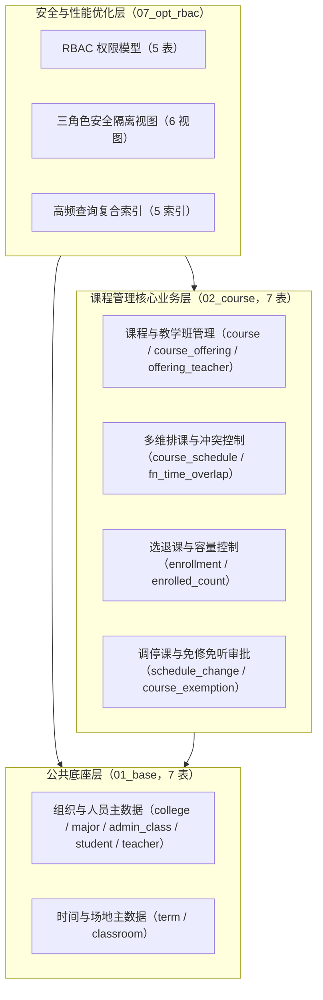
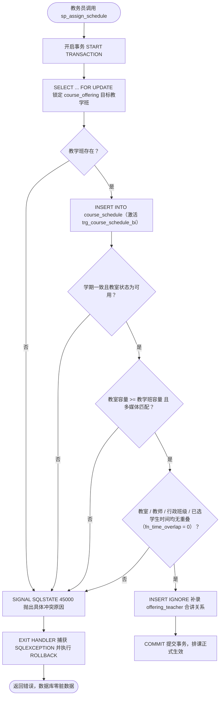
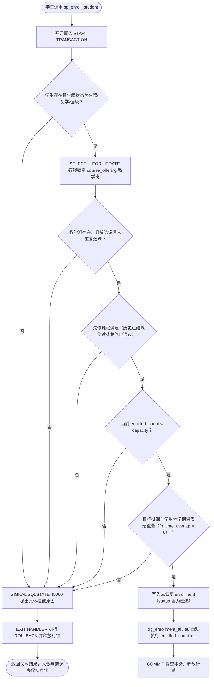
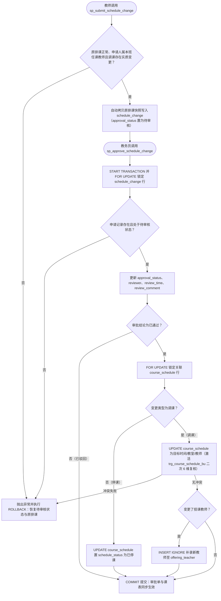

# 教务系统数据库系统设计文档（A 组长独立稿：公共底座、课程管理与安全优化）

> **所属课程**：数据库系统原理课程设计  
> **负责成员**：成员 A（组长）  
> **对应脚本**：`sql/01_base_ddl.sql`、`sql/02_course_ddl.sql`、`sql/07_opt_rbac.sql`  
> **交付范围**：公共底座与课程管理模块的功能及流程设计、逻辑结构与范式合规分析、有意识的反范式权衡设计、物理结构设计依据、RBAC 安全权限与三角色视图设计（选做）、核心索引设计（选做）、全量数据字典（选做）。  
> **合稿说明**：本文档严格遵循单向依赖原则，与成员 B/C/D/E 模块零耦合，可供成员 E 直接并入全组《系统设计文档》终稿。

---

## 1. 功能模块与核心流程设计

### 1.1 系统模块架构与阶段 1 用例对齐

系统数据库采用三层单向依赖架构：**公共底座层（`01_base`）** 提供全组共享的 7 张主数据表；**课程管理业务层（`02_course`）** 仅依赖公共底座，承载开课、多教师合讲、排课、选退课、调/停课审批与免修/免听审批 7 张业务表，并向上游成绩（B）、考试与教室（C）、毕设与评教（D）、学籍与师资（E）提供统一基准；**安全与性能优化层（`07_opt_rbac`）** 独立叠加 5 张 RBAC 权限表、6 个三角色安全隔离视图及 5 个高频复合索引。

**图 1-1 成员 A 数据库模块分层架构图**

**说明**：底座与课程业务层通过外键约束建立单向依赖，下游成员 B/C/D/E 仅需导入 `01_base` 与 `02_course` 并外键引用公共主键，严禁修改原表结构。表 1-1 给出了各子模块与阶段 1 需求分析用例（`UC-KC-01` 到 `UC-KC-15`）及底层数据库对象的严格映射关系。

**表 1-1 课程管理子模块与阶段 1 用例及数据库实现对齐表**

| 子模块 | 对应阶段 1 用例 | 核心数据表 | 核心函数 / 触发器 / 存储过程 / 视图 |
| :--- | :--- | :--- | :--- |
| **公共主数据底座** | 全组公共实体契约 | `college`、`major`、`admin_class`、`student`、`teacher`、`term`、`classroom` | `sp_seed_base_students`（造数） |
| **课程与教学班管理** | `UC-KC-01`、`UC-KC-14` | `course`、`course_offering`、`offering_teacher` | `trg_course_bi`/`bu`、`v_admin_offering_overview`、`v_student_available_electives` |
| **排课与多维冲突控制** | `UC-KC-02` | `course_schedule`、`course_offering`、`classroom`、`enrollment` | `fn_time_overlap`、`trg_course_schedule_bi`/`bu`、`sp_assign_schedule` |
| **学生选课与退课管理** | `UC-KC-03`、`UC-KC-04`、`UC-KC-09` | `enrollment`、`course_offering`、`course`、`course_exemption` | `trg_enrollment_bi`/`ai`/`bu`/`au`/`ad`、`sp_enroll_student`、`sp_drop_student`、`v_teacher_elective_roster` |
| **四类多维课表查询** | `UC-KC-05`、`UC-KC-06`、`UC-KC-07`、`UC-KC-08` | `course_schedule`、`course_offering`、`enrollment`、`classroom`、`teacher` | `v_student_timetable`、`v_teacher_my_courses`、课表复合索引 |
| **调/停课与免修免听审批** | `UC-KC-10`、`UC-KC-11`、`UC-KC-12`、`UC-KC-13`、`UC-KC-15` | `schedule_change`、`course_exemption`、`course_schedule` | `trg_schedule_change_bi`/`bu`、`sp_submit_schedule_change`、`sp_approve_schedule_change`、`v_admin_schedule_change_audit` |

### 1.2 核心业务技术流程设计

#### 流程 1：教务员排课多维冲突检测与事务回滚流程

排课业务由存储过程 `sp_assign_schedule` 封装事务边界，并在向 `course_schedule` 写入数据时由表级 `BEFORE INSERT` 触发器 `trg_course_schedule_bi`（更新场景由 `trg_course_schedule_bu`）自动执行全维度硬约束校验，底层统一调用纯函数 `fn_time_overlap` 判定时间槽重叠。

**图 1-2 教务员排课多维冲突检测与事务回滚流程图**

**技术说明**：将冲突校验下沉至 `trg_course_schedule_bi`/`bu` 触发器后，无论通过存储过程、批量事务还是直接 `INSERT`/`UPDATE` 语句操作 `course_schedule`，数据库均强制执行 6 维拦截（学期一致性、教室状态、教室容量与多媒体性质、教室时间冲突、教师时间冲突、面向班级与已选学生时间冲突）。若一个教学班需在单一事务内连续安排多个上课时段（如测试项 12 双时段排课），任一时段触发冲突均会引发 `ROLLBACK`，将先前已写入的时段一并撤销，彻底杜绝半成品排课残留。

#### 流程 2：学生选课容量原子控制与强一致计数流程

学生选课由 `sp_enroll_student` 承担并发控制与规则核验，配合 `enrollment` 表上的 5 个触发器（`trg_enrollment_bi`/`ai`/`bu`/`au`/`ad`）以及 `course_offering` 表上的 `chk_offering_enrolled_le_cap` 约束形成“行锁校验 + 触发器维护 + CHECK 兜底”三道防线。

**图 1-3 学生选课容量原子控制流程图**

**技术说明**：针对同教学班高并发抢课场景，`SELECT ... FROM course_offering ... FOR UPDATE` 仅锁定当前教学班单行记录，避免锁表影响其他课程选课，同时串行化判断 `enrolled_count < capacity`。退课操作调用 `sp_drop_student` 将记录置为 `已退` 并写入 `drop_time`，由 `trg_enrollment_au` 自动将 `enrolled_count` 减 1；若学生后续重选已退教学班，`sp_enroll_student` 复用既有 `(student_id, offering_id)` 唯一键行将其恢复为 `已选`，并经 `trg_enrollment_bu`/`au` 再次校验容量并递增计数。

#### 流程 3：教师调/停课审批与排课同步流程

调/停课流程分为“申请冻结快照（`sp_submit_schedule_change`）”与“审批原子同步（`sp_approve_schedule_change`）”两阶段，确保原排课历史凭证不可篡改，且审批通过瞬间二次复核目标时间场地冲突。

**图 1-4 教师调/停课申请与审批原子同步流程图**

**技术说明**：提交申请时，`sp_submit_schedule_change` 先核验申请教师为原授课教师或该教学班 `offering_teacher` 合讲成员（严格对齐 `UC-KC-10`），再结合 `trg_schedule_change_bi`/`bu` 与 `chk_sc_new_valid` 强制保证“调课必须完整填写目标周次、单双周、星期、节次、教室与教师，且至少有一项与原排课不同；停课则允许目标项为空”。审批通过修改 `course_schedule` 时，`trg_course_schedule_bu` 会自动排除本条记录（`cs.schedule_id <> OLD.schedule_id`）后重新检测 6 维冲突；一旦在等待审批期间目标教室被他人占用，触发器直接报错并使 `sp_approve_schedule_change` 整笔回滚，避免出现“审批单显示已通过但课表未更新”的状态分裂。

---

## 2. 逻辑结构设计与范式合规分析

### 2.1 全库表结构分层总览

成员 A 共在 `edu_system` 库中定义 **19 张表**：
- **公共底座层（`01_base_ddl.sql`，7 张）**：`college`、`major`、`admin_class`、`student`、`teacher`、`term`、`classroom`。
- **课程管理层（`02_course_ddl.sql`，7 张）**：`course`、`course_offering`、`offering_teacher`、`course_schedule`、`enrollment`、`schedule_change`、`course_exemption`。
- **安全权限层（`07_opt_rbac.sql`，5 张）**：`sys_role`、`sys_user`、`sys_user_role`、`sys_permission`、`sys_role_permission`。

### 2.2 完整关系模式清单

以下关系模式与 DDL 脚本逐项一致。约定：<u>下划线</u>标注主键（PK），`FK` 标注外键及参照表与级联动作，`UK` 标注唯一键，`CHK` 标注表级检查约束，`TRG` 标注由触发器补充实施的完整性约束。

#### 一、公共底座关系模式（7 张）

1. **`college`**（<u>`college_id`</u>, `college_name` NOT NULL, `office_location`, `contact_phone`, `created_at` NOT NULL）
   - **PK**：`college_id`；**UK**：`uk_college_name (college_name)`。
2. **`major`**（<u>`major_id`</u>, `major_name` NOT NULL, `college_id` NOT NULL, `required_elective_credits` NOT NULL, `duration_years` NOT NULL, `created_at` NOT NULL）
   - **PK**：`major_id`；**UK**：`uk_major_college_name (college_id, major_name)`。
   - **FK**：`fk_major_college (college_id)` → `college(college_id)`（`ON UPDATE CASCADE ON DELETE RESTRICT`）。
   - **CHK**：`chk_major_elective_credits (required_elective_credits >= 0)`；`chk_major_duration (duration_years BETWEEN 2 AND 8)`。
3. **`admin_class`**（<u>`admin_class_id`</u>, `class_name` NOT NULL, `grade` NOT NULL, `major_id` NOT NULL, `college_id` NOT NULL, `student_count` NOT NULL, `created_at` NOT NULL）
   - **PK**：`admin_class_id`；**UK**：`uk_admin_class_name (class_name)`。
   - **FK**：`fk_admin_class_major (major_id)` → `major(major_id)`、`fk_admin_class_college (college_id)` → `college(college_id)`（均 `ON UPDATE CASCADE ON DELETE RESTRICT`）。
   - **CHK**：`chk_admin_class_grade (grade BETWEEN 2000 AND 2100)`。
4. **`student`**（<u>`student_id`</u>, `student_name` NOT NULL, `gender` NOT NULL, `birth_date` NOT NULL, `grade` NOT NULL, `enrollment_status` NOT NULL, `is_graduating` NOT NULL, `family_info`, `phone`, `email`, `admin_class_id` NOT NULL, `major_id` NOT NULL, `college_id` NOT NULL, `created_at` NOT NULL）
   - **PK**：`student_id`。
   - **FK**：`fk_student_class (admin_class_id)` → `admin_class(admin_class_id)`、`fk_student_major (major_id)` → `major(major_id)`、`fk_student_college (college_id)` → `college(college_id)`（均 `ON UPDATE CASCADE ON DELETE RESTRICT`）。
   - **CHK**：`chk_student_grade (grade BETWEEN 2000 AND 2100)`；`chk_student_graduating (is_graduating IN (0, 1))`。
5. **`teacher`**（<u>`teacher_id`</u>, `teacher_name` NOT NULL, `gender` NOT NULL, `birth_date` NOT NULL, `age` NOT NULL, `title` NOT NULL, `college_id` NOT NULL, `phone`, `email`, `status` NOT NULL, `created_at` NOT NULL）
   - **PK**：`teacher_id`。
   - **FK**：`fk_teacher_college (college_id)` → `college(college_id)`（`ON UPDATE CASCADE ON DELETE RESTRICT`）。
   - **CHK**：`chk_teacher_age (age BETWEEN 22 AND 80)`。
6. **`term`**（<u>`term_id`</u>, `term_name` NOT NULL, `academic_year` NOT NULL, `semester_no` NOT NULL, `start_date` NOT NULL, `end_date` NOT NULL, `total_weeks` NOT NULL, `is_current` NOT NULL, `status` NOT NULL）
   - **PK**：`term_id`；**UK**：`uk_term_name (term_name)`。
   - **CHK**：`chk_term_semester_no (semester_no IN (1, 2, 3))`；`chk_term_total_weeks (total_weeks BETWEEN 1 AND 30)`；`chk_term_is_current (is_current IN (0, 1))`；`chk_term_dates (end_date > start_date)`。
7. **`classroom`**（<u>`classroom_id`</u>, `building` NOT NULL, `room_no` NOT NULL, `capacity` NOT NULL, `is_multimedia` NOT NULL, `room_type` NOT NULL, `status` NOT NULL, `created_at` NOT NULL）
   - **PK**：`classroom_id`；**UK**：`uk_classroom_loc (building, room_no)`。
   - **CHK**：`chk_classroom_capacity (capacity BETWEEN 10 AND 500)`；`chk_classroom_multimedia (is_multimedia IN (0, 1))`。

#### 二、课程管理关系模式（7 张）

8. **`course`**（<u>`course_id`</u>, `course_name` NOT NULL, `credit` NOT NULL, `hours` NOT NULL, `course_type` NOT NULL, `prereq_course_id`, `college_id` NOT NULL, `description`, `created_at` NOT NULL）
   - **PK**：`course_id`。
   - **FK**：`fk_course_prereq (prereq_course_id)` → `course(course_id)`（`ON UPDATE CASCADE ON DELETE SET NULL`）；`fk_course_college (college_id)` → `college(college_id)`（`ON UPDATE CASCADE ON DELETE RESTRICT`）。
   - **CHK / TRG**：`chk_course_credit (credit > 0 AND credit <= 12.0)`；`chk_course_hours (hours > 0 AND hours <= 240)`；`trg_course_bi`/`bu` 禁止 `prereq_course_id = course_id` 自引用（规避 MySQL 8 Error 3823）。
9. **`course_offering`**（<u>`offering_id`</u>, `course_id` NOT NULL, `term_id` NOT NULL, `target_class_id`, `capacity` NOT NULL, `enrolled_count` NOT NULL, `require_multimedia` NOT NULL, `status` NOT NULL, `created_at` NOT NULL）
   - **PK**：`offering_id`。
   - **FK**：`fk_offering_course (course_id)` → `course(course_id)`（`ON UPDATE CASCADE ON DELETE RESTRICT`）；`fk_offering_term (term_id)` → `term(term_id)`（`ON UPDATE CASCADE ON DELETE RESTRICT`）；`fk_offering_target_class (target_class_id)` → `admin_class(admin_class_id)`（`ON UPDATE CASCADE ON DELETE SET NULL`）。
   - **CHK**：`chk_offering_capacity (capacity BETWEEN 1 AND 500)`；`chk_offering_enrolled_le_cap (enrolled_count <= capacity)`；`chk_offering_multimedia (require_multimedia IN (0, 1))`。
10. **`offering_teacher`**（<u>`offering_id`, `teacher_id`</u>, `teacher_role` NOT NULL, `assigned_at` NOT NULL）
    - **PK**：复合主键 `(offering_id, teacher_id)`，将概念层的“教师–开课教学班 M:N 合讲授课”无损转化为关系模式。
    - **FK**：`fk_ot_offering (offering_id)` → `course_offering(offering_id)`（`ON UPDATE CASCADE ON DELETE CASCADE`）；`fk_ot_teacher (teacher_id)` → `teacher(teacher_id)`（`ON UPDATE CASCADE ON DELETE RESTRICT`）。
11. **`course_schedule`**（<u>`schedule_id`</u>, `offering_id` NOT NULL, `term_id` NOT NULL, `teacher_id` NOT NULL, `classroom_id` NOT NULL, `start_week` NOT NULL, `end_week` NOT NULL, `week_type` NOT NULL, `day_of_week` NOT NULL, `start_section` NOT NULL, `end_section` NOT NULL, `schedule_status` NOT NULL, `created_at` NOT NULL, `updated_at` NOT NULL）
    - **PK**：`schedule_id`（`AUTO_INCREMENT`）。
    - **FK**：`fk_sched_offering (offering_id)` → `course_offering(offering_id)`（`ON UPDATE CASCADE ON DELETE CASCADE`）；`fk_sched_term (term_id)` → `term(term_id)`、`fk_sched_teacher (teacher_id)` → `teacher(teacher_id)`、`fk_sched_classroom (classroom_id)` → `classroom(classroom_id)`（均 `ON UPDATE CASCADE ON DELETE RESTRICT`）。
    - **CHK / TRG**：`chk_sched_week_bounds (start_week BETWEEN 1 AND 25 AND end_week BETWEEN 1 AND 25 AND end_week >= start_week)`；`chk_sched_day_of_week (day_of_week BETWEEN 1 AND 7)`；`chk_sched_section_bounds (start_section BETWEEN 1 AND 12 AND end_section BETWEEN 1 AND 12 AND end_section >= start_section)`；`trg_course_schedule_bi`/`bu` 强制 6 维冲突与场地校验。
12. **`enrollment`**（<u>`enrollment_id`</u>, `student_id` NOT NULL, `offering_id` NOT NULL, `enroll_time` NOT NULL, `status` NOT NULL, `drop_time`）
    - **PK**：`enrollment_id`（`AUTO_INCREMENT`）；**UK**：`uk_enroll_student_offering (student_id, offering_id)`（防同一学生重复选修同一教学班）。
    - **FK**：`fk_enroll_student (student_id)` → `student(student_id)`、`fk_enroll_offering (offering_id)` → `course_offering(offering_id)`（均 `ON UPDATE CASCADE ON DELETE RESTRICT`）。
    - **TRG**：`trg_enrollment_bi`/`ai`/`bu`/`au`/`ad` 保障容量兜底与 `enrolled_count` 同步。
13. **`schedule_change`**（<u>`change_id`</u>, `schedule_id` NOT NULL, `term_id` NOT NULL, `applicant_teacher_id` NOT NULL, `change_type` NOT NULL, `orig_start_week` NOT NULL, `orig_end_week` NOT NULL, `orig_week_type` NOT NULL, `orig_day_of_week` NOT NULL, `orig_start_section` NOT NULL, `orig_end_section` NOT NULL, `orig_classroom_id` NOT NULL, `orig_teacher_id` NOT NULL, `new_start_week`, `new_end_week`, `new_week_type`, `new_day_of_week`, `new_start_section`, `new_end_section`, `new_classroom_id`, `new_teacher_id`, `reason` NOT NULL, `approval_status` NOT NULL, `apply_time` NOT NULL, `reviewer`, `review_time`, `review_comment`）
    - **PK**：`change_id`（`AUTO_INCREMENT`）。
    - **FK**：`fk_sc_schedule (schedule_id)` → `course_schedule(schedule_id)`、`fk_sc_term (term_id)` → `term(term_id)`、`fk_sc_applicant (applicant_teacher_id)` → `teacher(teacher_id)`、`fk_sc_orig_room (orig_classroom_id)` → `classroom(classroom_id)`、`fk_sc_orig_teacher (orig_teacher_id)` → `teacher(teacher_id)`、`fk_sc_new_room (new_classroom_id)` → `classroom(classroom_id)`、`fk_sc_new_teacher (new_teacher_id)` → `teacher(teacher_id)`（均 `ON UPDATE CASCADE ON DELETE RESTRICT`）。
    - **CHK / TRG**：`chk_sc_orig_valid` 校验原周次/星期/节次边界；`chk_sc_new_valid` 校验停课可空、调课时间字段必填且合法；`trg_schedule_change_bi`/`bu` 强制调课时 `new_classroom_id` 与 `new_teacher_id` 均非空且至少有一项目标要素与原排课不同。
14. **`course_exemption`**（<u>`exemption_id`</u>, `student_id` NOT NULL, `offering_id` NOT NULL, `exemption_type` NOT NULL, `reason` NOT NULL, `approval_status` NOT NULL, `teacher_review` NOT NULL, `teacher_reviewer`, `teacher_review_time`, `admin_review` NOT NULL, `admin_reviewer`, `admin_review_time`, `apply_time` NOT NULL）
    - **PK**：`exemption_id`（`AUTO_INCREMENT`）；**UK**：`uk_exemption_stu_off_type (student_id, offering_id, exemption_type)`。
    - **FK**：`fk_exemption_student (student_id)` → `student(student_id)`（`ON UPDATE CASCADE ON DELETE RESTRICT`）；`fk_exemption_offering (offering_id)` → `course_offering(offering_id)`（`ON UPDATE CASCADE ON DELETE RESTRICT`）；`fk_exemption_teacher_reviewer (teacher_reviewer)` → `teacher(teacher_id)`（`ON UPDATE CASCADE ON DELETE SET NULL`）。

#### 三、RBAC 安全权限关系模式（5 张）

15. **`sys_role`**（<u>`role_id`</u>, `role_code` NOT NULL, `role_name` NOT NULL, `description`, `created_at` NOT NULL）—— **PK** `role_id`；**UK** `uk_sys_role_code (role_code)`。
16. **`sys_user`**（<u>`user_id`</u>, `username` NOT NULL, `password_hash` NOT NULL, `display_name` NOT NULL, `role_type` NOT NULL, `ref_id`, `college_id`, `status` NOT NULL, `created_at` NOT NULL）—— **PK** `user_id`；**UK** `uk_sys_user_username (username)`；**FK** `fk_sys_user_college (college_id)` → `college(college_id)`（`ON UPDATE CASCADE ON DELETE SET NULL`）。
17. **`sys_user_role`**（<u>`user_id`, `role_id`</u>, `granted_at` NOT NULL）—— **PK** `(user_id, role_id)`；**FK** `fk_sur_user (user_id)` → `sys_user(user_id)`、`fk_sur_role (role_id)` → `sys_role(role_id)`（均 `ON UPDATE CASCADE ON DELETE CASCADE`）。
18. **`sys_permission`**（<u>`perm_id`</u>, `perm_code` NOT NULL, `perm_name` NOT NULL, `module_name` NOT NULL, `action_type` NOT NULL）—— **PK** `perm_id`；**UK** `uk_sys_perm_code (perm_code)`。
19. **`sys_role_permission`**（<u>`role_id`, `perm_id`</u>）—— **PK** `(role_id, perm_id)`；**FK** `fk_srp_role (role_id)` → `sys_role(role_id)`、`fk_srp_perm (perm_id)` → `sys_permission(perm_id)`（均 `ON UPDATE CASCADE ON DELETE CASCADE`）。

### 2.3 范式合规分析

1. **满足第一范式（1NF）**：全部 19 张表的每个字段均为不可再分的原子标量。例如，统一上课时间没有使用“第1-16周单周周一1-2节”这类复合字符串，而是拆分为 `term_id`、`start_week`、`end_week`、`week_type`、`day_of_week`、`start_section`、`end_section` 7 个原子字段；多教师合讲没有在 `course_offering` 中逗号拼接多个工号，而是拆出 `offering_teacher` 关联表。
2. **满足第二范式（2NF）**：16 张单列主键表不存在部分函数依赖；3 张复合主键表（`offering_teacher`、`sys_user_role`、`sys_role_permission`）的非主属性（`teacher_role`、`assigned_at`、`granted_at`）均完全函数依赖于各自复合主键整体，不依赖主键的任意真子集。
3. **主体满足第三范式（3NF）与 BCNF**：各核心实体表均将抽象定义与具体运行实例分离（`course` 与 `course_offering` 分离，`classroom` 与 `course_schedule` 分离，`sys_role` 与 `sys_permission` 分离），所有主表候选码（如 `classroom(building, room_no)`、`enrollment(student_id, offering_id)`）均构成决定因素，消除了常规插入、删除与更新异常。
4. **受控偏离说明**：仅在少数高频并发、多维检索与历史追溯路径上保留了 5 处**有意识的反范式冗余字段**，其业务必要性、维护代价与强一致保障机制详见第 3 章。

---

## 3. 有意识的反范式权衡设计

在满足主体 3NF/BCNF 的基础上，为避免选课高峰并发锁争用、课表查询多重连接与历史审批轨迹丢失，系统有意识地引入了 5 处受控冗余，并在表 3-1 中明确列出每处权衡的理由、代价与一致性保障手段。

**表 3-1 有意识的反范式冗余设计权衡与一致性保障清单**

| 序号 | 表与冗余字段 | 偏离的规范化形态 | 为什么反范式（解决的痛点） | 引入的代价 | 数据一致性保障机制 |
| :---: | :--- | :--- | :--- | :--- | :--- |
| 1 | `course_offering.enrolled_count` | 衍生聚合值冗余（本可由 `COUNT(*)` 统计 `enrollment` 得出） | 选课高峰期若每次检查名额、浏览余量或统计开课都对 5 万+ 行 `enrollment` 执行聚合扫描，不仅延迟高且易引发间隙锁争用；冗余计数后可通过主键点查直接判断 `enrolled_count < capacity` | 每次选课/退课/删课多 1 次 `course_offering` 单行更新（写放大），须防计数与明细漂移 | **三重强一致保障**：① `trg_enrollment_bi`/`ai`/`bu`/`au`/`ad` 5 个触发器覆盖增改删全生命周期自动维护；② `sp_enroll_student` 对教学班加 `FOR UPDATE` 行锁串行化防超卖；③ `chk_offering_enrolled_le_cap (enrolled_count <= capacity)` 表级硬约束兜底 |
| 2 | `course_schedule.term_id`、`schedule_change.term_id` | 传递依赖冗余（本可沿 `offering_id -> course_offering.term_id` 或 `schedule_id -> course_schedule.term_id` 推导） | 学生/教师/教室课表查询、排课冲突检测与学院调课统计几乎均以 `term_id` 为首要过滤维度；冗余 `term_id` 后可直接在单表上建立 `(term_id, classroom_id, ...)` 等最左前缀复合索引，免去每次回连 `course_offering` | 每行增加少量存储空间；写入排课或调课记录时须确保学期与上游教学班一致 | ① `trg_course_schedule_bi`/`bu` 强制核验 `NEW.term_id = course_offering.term_id`，不符即抛异常拦截；② `sp_assign_schedule` 与 `sp_submit_schedule_change` 自动从上游主记录派生 `term_id`；③ 外键 `fk_sched_term`/`fk_sc_term` 约束参照有效 |
| 3 | `student.major_id`、`student.college_id`、`admin_class.college_id` | 组织层级传递冗余（本可沿 `admin_class -> major -> college` 多跳推导） | 支撑成绩模块（按专业+年级查不及格与毕业选修学分）、学籍模块（按学院统计在籍人数）与学院数据域隔离查询，消除 3–4 表级联连接，并可直接落地 `idx_student_major_grade` 与 `idx_student_college_status` 复合索引 | 学生转专业或转院时需同步更新 `admin_class_id`、`major_id` 与 `college_id` 三个字段 | 三个字段均受外键 `ON UPDATE CASCADE ON DELETE RESTRICT` 保护；造数过程 `sp_seed_base_students` 自动从 `admin_class` 查取一致写入，生产环境由学籍异动事务统一维护 |
| 4 | `admin_class.student_count`、`teacher.age` | 衍生统计属性冗余（本可由学生表聚合或 `birth_date` 动态计算） | 教务员频繁查询各班人数与全校师资年龄结构分布；若对 `birth_date` 执行 `TIMESTAMPDIFF` 函数计算既耗 CPU 又无法利用索引，冗余 `age` 与 `student_count` 可实现毫秒级分组汇总 | 班级人数随学籍变动变化、教师年龄每年自然递增，存在周期性刷新成本 | `01_base_seed.sql` 造数完毕自动回写 `admin_class.student_count`；`chk_teacher_age (age BETWEEN 22 AND 80)` 做合法域保护，生产环境通过学籍异动触发逻辑及年度定时任务刷新 |
| 5 | `schedule_change.orig_*` 8 个原排课快照列 | 历史凭证快照冗余（与 `course_schedule` 当前值并存） | 调课审批通过后 `course_schedule` 会被改写为新时间/教室/教师；若不冗余快照，原上课周次、节次、地点与教师将被永久覆盖，无法满足测试项 1 审计追踪需求 | `schedule_change` 单行宽度略增 | `sp_submit_schedule_change` 在申请提交瞬间直接从 `course_schedule` 原子拷贝冻结，审批流程仅更新目标态与审批列，永不回写 `orig_*` 快照列 |

---

## 4. 物理结构设计依据

### 4.1 存储引擎选型依据

全库 19 张表统一采用 **`InnoDB`** 存储引擎，设计依据如下：
1. **ACID 事务与崩溃恢复**：排课多时段原子提交/回滚、学生选退课联动维护 `enrolled_count`、调课审批同步修改排课均依赖 InnoDB 的 `redo log` 与 `undo log` 机制，确保任一步异常即可原子回滚且实例异常重启后数据零丢失。
2. **行级锁与 MVCC 并发控制**：相较 MyISAM 表级锁，InnoDB 支持 MVCC 快照读（课表查询与开课统计不阻塞选课写入）及基于索引的行级排他锁（`sp_enroll_student` 仅锁定单个 `offering_id` 行），直接支撑高并发选课防超卖。
3. **原生外键参照完整性**：全库 35 条外键约束（`01_base` 7 条、`02_course` 23 条、`07_opt_rbac` 5 条，涵盖 `RESTRICT`/`CASCADE`/`SET NULL` 策略）均由 InnoDB 底层强制执行，避免跨模块孤儿记录。
4. **聚簇索引加速主键点查**：数据页按主键 B+ 树组织，`student_id`、`offering_id`、`schedule_id` 等高频主键连接（`eq_ref`）可直接定位行记录。

### 4.2 字符集与排序规则依据

数据库与全表统一采用 **`utf8mb4`** 字符集与 **`utf8mb4_0900_ai_ci`** 排序规则：
- `utf8mb4` 完整支持 1 到 4 字节 UTF-8 编码，可无损存储中文姓名生僻字、课程简介特殊符号，彻底规避 MySQL 历史 `utf8mb3` 的截断隐患。
- `utf8mb4_0900_ai_ci` 为 MySQL 8.0 默认排序规则，基于 Unicode 9.0 规范实现，兼顾中文字符与英文编号的检索准确性，同时与 `01_base` 到 `07_opt_rbac` 及下游 B/C/D/E 扩展脚本保持一致，避免跨表连接因排序规则不统一引发隐式字符集转换导致索引失效。

### 4.3 关键字段数据类型与长度选型依据

在满足业务语义的前提下坚持“最小够用、定精防误差、窄键利索引”的选型原则（表 4-1）。

**表 4-1 关键字段物理数据类型与长度选型依据**

| 数据类别 | 选型类型与长度 | 代表字段 | 物理设计依据 |
| :--- | :--- | :--- | :--- |
| **业务主编码** | `VARCHAR(16)` | `student_id`、`teacher_id`、`course_id`、`offering_id`、`term_id`、`classroom_id` | 既支持可读种子编号（如 `S001`、`2026-1`），又兼容高校 10–12 位正式学号/工号并预留扩展余量；长度适中，作为外键与二级索引前缀开销可控 |
| **高频流水主键** | `BIGINT UNSIGNED AUTO_INCREMENT` | `schedule_id`、`enrollment_id`、`change_id`、`exemption_id` | 单调自增写入符合 InnoDB 聚簇索引顺序追加特性，大幅减少 B+ 树页分裂；无符号 64 位整型消除多学年累积溢出风险 |
| **微小范围正整数** | `TINYINT UNSIGNED`（1 字节） | `start_week`、`end_week`、`day_of_week`、`start_section`、`end_section`、`age`、`duration_years`、`semester_no` | 值域均在 `0` 到 `255` 内（配合 `CHECK` 限定如 `1–25` 周、`1–7` 星期、`1–12` 节），相较 `INT` 节省 75% 存储空间并显著压缩索引键长 |
| **中小范围正整数** | `SMALLINT UNSIGNED`（2 字节） | `capacity`、`enrolled_count`、`student_count`、`grade`、`hours` | 覆盖 `0` 到 `65535`，足够表示教室/教学班容量（`1–500`）、学时（`1–240`）与入学年份（`2000–2100`），比 `INT` 节省 50% 空间 |
| **布尔标记** | `TINYINT(1)` | `is_graduating`、`is_multimedia`、`require_multimedia`、`is_current` | 仅占 1 字节并辅以 `CHECK (... IN (0, 1))` 严格二值化，语义清晰且避免多驱动布尔映射歧义 |
| **精确学分数值** | `DECIMAL(3,1)` / `DECIMAL(5,1)` | `course.credit`、`major.required_elective_credits` | 课程学分常见 `.5` 小数（如 `3.5`、`2.5`），使用定点数避免 `FLOAT`/`DOUBLE` 二进制浮点误差导致毕业学分汇总偏差 |
| **有限离散枚举** | `ENUM(...)` | `gender`、`course_type`、`week_type`、`enrollment.status`、`approval_status`、`title` | 内部以 1–2 字节整数编码存储（索引 `key_len` 仅占 1 字节，实测见 Q1/Q4），兼具极低存储占用与表级非法值强拦截能力 |
| **日期与时间戳** | `DATE` / `DATETIME` | `birth_date`、`start_date`、`enroll_time`、`review_time`、`created_at` | `DATE` 占 3 字节精确存储生日与起止日；`DATETIME` 占 5 字节覆盖 `1000–9999` 年，避开 `TIMESTAMP` 的 2038 年上限，统一由数据库 `CURRENT_TIMESTAMP` 生成 |
| **定长安全摘要** | `CHAR(64)` | `sys_user.password_hash` | 对应固定 64 位十六进制 SHA-256 摘要（生产环境可切换为定长/变长加盐 Argon2/bcrypt 哈希串），避免变长长度前缀开销 |

### 4.4 物理存储架构、分区演进与备份恢复策略（选做）

1. **事务隔离与并发锁策略**：沿用 InnoDB 默认 `REPEATABLE READ` 隔离级别，常规课表与统计查询走无锁 MVCC 快照读；选课、排课与调课审批统一在短事务内按固定顺序对目标主键加 `FOR UPDATE` 行锁，避免循环等待死锁并严防超卖。
2. **冷热分离、分区与读写分离演进**：
   - **按学期归档与分区思路**：`enrollment`、`course_schedule`、`schedule_change` 随学年线性增长，而 90% 以上在线读写集中于当前学期（`is_current = 1`）。考虑到 MySQL 8 原生分区表不支持外键约束，生产架构采取“**在线库保留外键保障强一致 + 历史已结课学期按 `term_id` 定期归档至按学期 `RANGE/LIST COLUMNS` 分区的归档库**”方案，既不牺牲在线期参照完整性，又控制在线热表规模常年稳定。
   - **主从读写分离**：引入“一主多从（基于 GTID + 半同步复制）”架构，主库专注承载排课、选退课与审批写事务，只读从库承接四类课表高频查询及全校开课/调课统计报表，防止统计扫描挤占在线选课事务资源。
3. **备份与时间点恢复（PITR）策略**：
   - **每日全量逻辑热备**：在每日业务低峰期（如 03:00）通过 `mysqldump --single-transaction --routines --triggers --events --master-data=2 edu_system` 基于 InnoDB 一致性快照执行在线无锁全备，连同存储过程、函数与触发器一并备份。
   - **实时增量日志备份**：开启 `binlog`（`binlog_format = ROW`，`sync_binlog = 1`，`innodb_flush_log_at_trx_commit = 1` 实现双一持久化），按小时归档增量日志至异地存储。
   - **容灾恢复流程**：发生磁盘损坏或误删数据时，先恢复最近一次全量备份，再通过 `mysqlbinlog` 按精准位置或时间戳重放增量日志至故障前一刻（PITR），确保排课、选课与审批数据零丢失；每学期开学选课前执行一次演练恢复校验。

---

## 5. 安全权限模型与核心索引设计（选做加分项）

### 5.1 RBAC 权限模型设计

`07_opt_rbac.sql` 实现了标准 5 表 RBAC 模型（`sys_role`、`sys_user`、`sys_user_role`、`sys_permission`、`sys_role_permission`），初始化教务员（`ROLE_ADMIN`）、教师（`ROLE_TEACHER`）、学生（`ROLE_STUDENT`）3 类角色、5 个示范账号（`U_ADM01`、`U_T001`、`U_T002`、`U_S001`、`U_S011`）以及 13 项细粒度课程业务权限点（`P01` 到 `P13`，见表 5-1）。

**表 5-1 三角色最小权限分配矩阵（`sys_role_permission`）**

| 权限编号 | 权限标识（`perm_code`） | 操作类别 | 教务员 (`ROLE_ADMIN`) | 教师 (`ROLE_TEACHER`) | 学生 (`ROLE_STUDENT`) |
| :---: | :--- | :---: | :---: | :---: | :---: |
| `P01` | `course:read`（浏览课程与教学班） | `READ` | 拥有 | 拥有 | 拥有 |
| `P02` | `course:write`（维护课程与开课教学班） | `WRITE` | 拥有 | — | — |
| `P03` | `schedule:assign`（教务员排课与冲突核查） | `WRITE` | 拥有 | — | — |
| `P04` | `schedule:read_all`（查询全校四类课表） | `READ` | 拥有 | — | — |
| `P05` | `schedule:read_self`（查询个人课表） | `READ` | — | 拥有 | 拥有 |
| `P06` | `schedule_change:apply`（提交调/停课申请） | `WRITE` | — | 拥有 | — |
| `P07` | `schedule_change:approve`（审批调/停课申请） | `APPROVE` | 拥有 | — | — |
| `P08` | `enroll:self`（学生自主选课/退课） | `WRITE` | — | — | 拥有 |
| `P09` | `enroll:read_roster`（查看本人所授选修课名单） | `READ` | — | 拥有 | — |
| `P10` | `exemption:apply`（提交免修/免听申请） | `WRITE` | — | — | 拥有 |
| `P11` | `exemption:teacher_review`（任课教师初审免听） | `APPROVE` | — | 拥有 | — |
| `P12` | `exemption:admin_review`（教务员终审免修/免听） | `APPROVE` | 拥有 | — | — |
| `P13` | `stats:course_audit`（统计全校开课与学院调课） | `STATS` | 拥有 | — | — |

**数据库引擎级最小授权落地方案**：`07_opt_rbac.sql` 同时附带 MySQL 8 原生 `CREATE ROLE` / `GRANT` 参考脚本（`'role_edu_admin'`、`'role_edu_teacher'`、`'role_edu_student'`）：
- 教务员角色授予 `edu_system.*` 读写与存储过程执行权；
- 教师角色**仅授予** `v_teacher_my_courses`、`v_teacher_elective_roster` 只读权及 `sp_submit_schedule_change` 执行权，禁止直读 `student` 基表隐私列或直接修改 `course_schedule`；
- 学生角色**仅授予** `v_student_timetable`、`v_student_available_electives` 只读权及 `sp_enroll_student`/`sp_drop_student` 执行权，彻底阻断绕过容量校验直接篡改 `enrollment` 或 `course_offering` 的越权路径。

### 5.2 三角色安全隔离视图设计

面向教务员、教师与学生三类角色设计了 **6 个只读隔离视图**（表 5-2），在数据库层强制执行**列级隐私脱敏**与**行级业务过滤**。

**表 5-2 三角色安全隔离视图设计清单**

| 视图名称 | 面向角色 | 关联基表 | 行级过滤与数据域隔离机制 | 列级裁剪与隐私保护说明 |
| :--- | :---: | :--- | :--- | :--- |
| `v_admin_offering_overview` | 教务员 | `course_offering`、`course`、`college`、`admin_class` | 全校可见，按 `college_id`/`term_id` 筛选，内置计算列 `remaining_seats` | 聚焦教学运行指标，屏蔽账号密码与个人隐私 |
| `v_admin_schedule_change_audit` | 教务员 | `schedule_change`、`teacher`、`college` | 全校/分院调停课审批与统计台账，按 `college_id`/`term_id`/`approval_status` 过滤 | 完整展示原/目标教室与教师及审批记录，屏蔽教师联系方式与年龄 |
| `v_teacher_my_courses` | 教师 | `course_schedule`、`teacher`、`course_offering`、`course`、`classroom` | 固定过滤 `cs.schedule_status = '正常'`；应用层按会话绑定 `teacher_id = ref_id` 实现本人行级隔离 | 仅暴露授课时间、地点与容量进度，屏蔽 `teacher.age`/`birth_date`/`phone` |
| `v_teacher_elective_roster` | 教师 | `offering_teacher`、`course_offering`、`course`、`enrollment`、`student`、`major`、`admin_class` | 固定过滤 `e.status = '已选'`；按 `ot.teacher_id = ref_id` 限制仅看本人合讲/主讲教学班名单 | **严格裁剪学生 `family_info`、`birth_date`、`phone`、`email` 等敏感隐私列** |
| `v_student_timetable` | 学生 | `enrollment`、`student`、`course_offering`、`course`、`course_schedule`、`teacher`、`classroom` | 固定过滤 `e.status = '已选'` 且 `cs.schedule_status = '正常'`；按 `e.student_id = ref_id` 隔离本人课表 | 仅公开教师姓名与职称，**屏蔽教师 `age`/`birth_date`/`phone` 及他人选课与学籍隐私** |
| `v_student_available_electives` | 学生 | `course_offering`、`course`、`college` | 固定过滤 `co.status IN ('选课中', '已开课')`，隐藏未开课、已结课与已停开教学班 | 公开学分、先修课提示与实时 `remaining_seats`，不暴露任何师生个人数据 |

### 5.3 核心复合索引设计

除 `01_base_ddl.sql` 与 `02_course_ddl.sql` 中已建立的主键、唯一键及必要外键单列索引外，针对高频课表检索、大表选课名单分页、全校选课热度聚合及学院调课统计四类重查询，在 `07_opt_rbac.sql` 中落地 **5 个精细化复合索引**（表 5-3）。

**表 5-3 高频查询核心复合索引设计表（`07_opt_rbac.sql`）**

| 索引名称 | 所属表 | 字段定义与顺序 | 服务核心场景 | 最左前缀与覆盖索引设计依据 |
| :--- | :--- | :--- | :--- | :--- |
| `idx_enroll_off_status_time` | `enrollment` | `(offering_id, status, enroll_time DESC, student_id)` | 查询某教学班有效选课名单并按选课时间倒序分页（`LIMIT`） | 等值列 `(offering_id, status)` 置于最左；倒序排序列 `enroll_time DESC` 紧随其后（利用 MySQL 8 降序索引消除 `Using filesort`）；尾部附加 `student_id` 实现连接驱动侧全覆盖索引扫描（`Using index`） |
| `idx_enroll_status_time_off` | `enrollment` | `(status, enroll_time, offering_id)` | 统计某时间窗口内全校有效选课各教学班热度分布 | 等值列 `status` 在前、范围列 `enroll_time >= ?` 在中，避免全索引扫描转变为 `range` 扫描；尾部包含 `offering_id` 使 `GROUP BY offering_id` 免回表读取聚簇索引 |
| `idx_sched_term_room_status_time` | `course_schedule` | `(term_id, classroom_id, schedule_status, day_of_week, start_section)` | 教室课表查询与排课教室时间冲突检测 | 三个高频等值条件 `(term_id, classroom_id, schedule_status)` 构成最左前缀直接命中目标少数行，彻底消除双单列索引交集（`index_merge`）；后置 `(day_of_week, start_section)` 使结果天然有序，消除 `Using filesort` |
| `idx_sched_term_teacher_status_time` | `course_schedule` | `(term_id, teacher_id, schedule_status, day_of_week, start_section)` | 教师个人课表查询与排课教师时间冲突检测 | 与教室课表对称设计，将教师课表定位与 `ORDER BY day_of_week, start_section` 合并为单次有序范围检索，避免临时排序 |
| `idx_sc_term_status_teacher_type` | `schedule_change` | `(term_id, approval_status, applicant_teacher_id, change_type)` | 教务员统计某学期已通过调/停课按教师分组次数 | 等值列 `(term_id, approval_status)` 快速过滤；分组列 `applicant_teacher_id` 紧随其后支持索引顺序聚合（消除 `Using temporary`）；尾部包含 `change_type` 使 `SUM(change_type = '调课')` 实现纯覆盖索引扫描免回表 |

---

## 6. 全量数据字典（选做加分项）

以下列出公共底座（7 张）、课程管理（7 张）与 RBAC 权限（5 张）共 **19 张表**的完整字段级数据字典，可直接由成员 E 合入全组数据字典总表。

### 6.1 公共底座表数据字典（`01_base_ddl.sql`）

#### 表 6-1 学院基础表（`college`）

| 字段名 | 数据类型 | 允许空 | 键 / 约束 / 默认值 | 说明 |
| :--- | :--- | :---: | :--- | :--- |
| `college_id` | `VARCHAR(16)` | 否 | `PK` | 学院编号（如 `COL01`） |
| `college_name` | `VARCHAR(64)` | 否 | `UK (uk_college_name)` | 学院名称 |
| `office_location` | `VARCHAR(64)` | 是 | — | 学院办公地点 |
| `contact_phone` | `VARCHAR(32)` | 是 | — | 学院联系电话 |
| `created_at` | `DATETIME` | 否 | `DEFAULT CURRENT_TIMESTAMP` | 创建时间 |

#### 表 6-2 专业基础表（`major`）

| 字段名 | 数据类型 | 允许空 | 键 / 约束 / 默认值 | 说明 |
| :--- | :--- | :---: | :--- | :--- |
| `major_id` | `VARCHAR(16)` | 否 | `PK` | 专业编号（如 `MAJ01`） |
| `major_name` | `VARCHAR(64)` | 否 | `UK (college_id, major_name)` | 专业名称 |
| `college_id` | `VARCHAR(16)` | 否 | `FK -> college`, `KEY (idx_major_college)` | 所属学院编号 |
| `required_elective_credits` | `DECIMAL(5,1)` | 否 | `DEFAULT 12.0`, `CHECK (>= 0)` | 毕业要求专业选修课学分 |
| `duration_years` | `TINYINT UNSIGNED` | 否 | `DEFAULT 4`, `CHECK (2–8)` | 标准学制（年） |
| `created_at` | `DATETIME` | 否 | `DEFAULT CURRENT_TIMESTAMP` | 创建时间 |

#### 表 6-3 行政班级表（`admin_class`）

| 字段名 | 数据类型 | 允许空 | 键 / 约束 / 默认值 | 说明 |
| :--- | :--- | :---: | :--- | :--- |
| `admin_class_id` | `VARCHAR(16)` | 否 | `PK` | 行政班级编号（如 `CLS01`） |
| `class_name` | `VARCHAR(64)` | 否 | `UK (uk_admin_class_name)` | 班级名称（如 `计科2023-1班`） |
| `grade` | `SMALLINT UNSIGNED` | 否 | `CHECK (2000–2100)` | 入学年级（如 `2023`、`2024`） |
| `major_id` | `VARCHAR(16)` | 否 | `FK -> major`, `KEY (major_id, grade)` | 所属专业编号 |
| `college_id` | `VARCHAR(16)` | 否 | `FK -> college`, `KEY (idx_admin_class_college)` | 所属学院编号（受控冗余） |
| `student_count` | `SMALLINT UNSIGNED` | 否 | `DEFAULT 0` | 班级在籍人数（受控冗余） |
| `created_at` | `DATETIME` | 否 | `DEFAULT CURRENT_TIMESTAMP` | 创建时间 |

#### 表 6-4 学生基础信息表（`student`）

| 字段名 | 数据类型 | 允许空 | 键 / 约束 / 默认值 | 说明 |
| :--- | :--- | :---: | :--- | :--- |
| `student_id` | `VARCHAR(16)` | 否 | `PK` | 学生学号（如 `S001`） |
| `student_name` | `VARCHAR(64)` | 否 | — | 学生姓名 |
| `gender` | `ENUM('男','女')` | 否 | — | 性别 |
| `birth_date` | `DATE` | 否 | — | 出生日期（视图脱敏隐藏） |
| `grade` | `SMALLINT UNSIGNED` | 否 | `CHECK (2000–2100)` | 所在年级（预留供 B/D/E 使用） |
| `enrollment_status` | `ENUM('在读','休学','复学','留级','退学','肄业','已毕业')` | 否 | `DEFAULT '在读'` | 学籍状态（预留供学籍模块使用） |
| `is_graduating` | `TINYINT(1)` | 否 | `DEFAULT 0`, `CHECK (IN (0,1))` | 毕业年级标记（`1` 毕业年级，`0` 非毕业年级） |
| `family_info` | `VARCHAR(255)` | 是 | — | 家庭情况（供学籍统计，对教师/学生脱敏） |
| `phone` | `VARCHAR(32)` | 是 | — | 联系电话（视图脱敏隐藏） |
| `email` | `VARCHAR(100)` | 是 | — | 电子邮箱 |
| `admin_class_id` | `VARCHAR(16)` | 否 | `FK -> admin_class`, `KEY (idx_student_class)` | 所属行政班级编号 |
| `major_id` | `VARCHAR(16)` | 否 | `FK -> major`, `KEY (major_id, grade, is_graduating)` | 所属专业编号（受控冗余） |
| `college_id` | `VARCHAR(16)` | 否 | `FK -> college`, `KEY (college_id, enrollment_status)` | 所属学院编号（受控冗余） |
| `created_at` | `DATETIME` | 否 | `DEFAULT CURRENT_TIMESTAMP` | 创建时间 |

#### 表 6-5 教师基础信息表（`teacher`）

| 字段名 | 数据类型 | 允许空 | 键 / 约束 / 默认值 | 说明 |
| :--- | :--- | :---: | :--- | :--- |
| `teacher_id` | `VARCHAR(16)` | 否 | `PK` | 教师工号（如 `T001`） |
| `teacher_name` | `VARCHAR(64)` | 否 | — | 教师姓名 |
| `gender` | `ENUM('男','女')` | 否 | — | 性别 |
| `birth_date` | `DATE` | 否 | — | 出生日期（视图脱敏隐藏） |
| `age` | `TINYINT UNSIGNED` | 否 | `CHECK (22–80)` | 年龄（供师资年龄结构统计） |
| `title` | `ENUM('教授','副教授','讲师','助教')` | 否 | `KEY (college_id, title)` | 职称（供师资职称统计） |
| `college_id` | `VARCHAR(16)` | 否 | `FK -> college`, `KEY (college_id, title)` | 所属学院编号 |
| `phone` | `VARCHAR(32)` | 是 | — | 联系电话（视图脱敏隐藏） |
| `email` | `VARCHAR(100)` | 是 | — | 电子邮箱 |
| `status` | `ENUM('在职','离职','退休')` | 否 | `DEFAULT '在职'` | 在职状态 |
| `created_at` | `DATETIME` | 否 | `DEFAULT CURRENT_TIMESTAMP` | 创建时间 |

#### 表 6-6 教学学期基准表（`term`）

| 字段名 | 数据类型 | 允许空 | 键 / 约束 / 默认值 | 说明 |
| :--- | :--- | :---: | :--- | :--- |
| `term_id` | `VARCHAR(16)` | 否 | `PK` | 学期编号（如 `2026-1`、`2025-2`） |
| `term_name` | `VARCHAR(64)` | 否 | `UK (uk_term_name)` | 学期全称 |
| `academic_year` | `VARCHAR(16)` | 否 | — | 所属学年（如 `2026-2027`） |
| `semester_no` | `TINYINT UNSIGNED` | 否 | `CHECK (IN (1,2,3))` | 学期序号（`1` 秋、`2` 春、`3` 小学期） |
| `start_date` | `DATE` | 否 | `CHECK (end_date > start_date)` | 学期开始日期 |
| `end_date` | `DATE` | 否 | `CHECK (end_date > start_date)` | 学期结束日期 |
| `total_weeks` | `TINYINT UNSIGNED` | 否 | `DEFAULT 18`, `CHECK (1–30)` | 总教学周数 |
| `is_current` | `TINYINT(1)` | 否 | `DEFAULT 0`, `CHECK (IN (0,1))` | 是否当前学期（`1` 是，`0` 否） |
| `status` | `ENUM('规划中','选课中','进行中','已结束')` | 否 | `DEFAULT '进行中'` | 学期状态 |

#### 表 6-7 物理教室资源表（`classroom`）

| 字段名 | 数据类型 | 允许空 | 键 / 约束 / 默认值 | 说明 |
| :--- | :--- | :---: | :--- | :--- |
| `classroom_id` | `VARCHAR(16)` | 否 | `PK` | 教室编号（如 `R001`） |
| `building` | `VARCHAR(32)` | 否 | `UK (building, room_no)` | 教学楼名称（如 `教三楼`） |
| `room_no` | `VARCHAR(16)` | 否 | `UK (building, room_no)` | 房间号（如 `301`） |
| `capacity` | `SMALLINT UNSIGNED` | 否 | `CHECK (10–500)`, `KEY (capacity, is_multimedia, status)` | 最大容纳人数 |
| `is_multimedia` | `TINYINT(1)` | 否 | `DEFAULT 1`, `CHECK (IN (0,1))` | 是否支持多媒体（`1` 支持，`0` 不支持） |
| `room_type` | `ENUM('普通教室','多媒体教室','阶梯教室','计算机机房','专业实验室')` | 否 | `DEFAULT '多媒体教室'` | 教室类型 |
| `status` | `ENUM('可用','维修中','停用')` | 否 | `DEFAULT '可用'` | 教室可用状态 |
| `created_at` | `DATETIME` | 否 | `DEFAULT CURRENT_TIMESTAMP` | 创建时间 |

### 6.2 课程管理表数据字典（`02_course_ddl.sql`）

#### 表 6-8 培养方案课程库表（`course`）

| 字段名 | 数据类型 | 允许空 | 键 / 约束 / 默认值 | 说明 |
| :--- | :--- | :---: | :--- | :--- |
| `course_id` | `VARCHAR(16)` | 否 | `PK` | 课程编号（如 `C001`） |
| `course_name` | `VARCHAR(100)` | 否 | — | 课程名称 |
| `credit` | `DECIMAL(3,1)` | 否 | `CHECK (> 0 AND <= 12.0)` | 学分 |
| `hours` | `SMALLINT UNSIGNED` | 否 | `CHECK (> 0 AND <= 240)` | 总学时 |
| `course_type` | `ENUM('必修','专业选修','公选')` | 否 | `KEY (college_id, course_type)` | 课程性质 |
| `prereq_course_id` | `VARCHAR(16)` | 是 | `FK -> course`, `KEY (idx_course_prereq)`, `TRG` 防自引 | 先修课程编号（自引用，可空） |
| `college_id` | `VARCHAR(16)` | 否 | `FK -> college`, `KEY (college_id, course_type)` | 开课学院编号 |
| `description` | `VARCHAR(255)` | 是 | — | 课程简介 |
| `created_at` | `DATETIME` | 否 | `DEFAULT CURRENT_TIMESTAMP` | 创建时间 |

#### 表 6-9 开课教学班表（`course_offering`）

| 字段名 | 数据类型 | 允许空 | 键 / 约束 / 默认值 | 说明 |
| :--- | :--- | :---: | :--- | :--- |
| `offering_id` | `VARCHAR(16)` | 否 | `PK` | 开课教学班编号（如 `O001`） |
| `course_id` | `VARCHAR(16)` | 否 | `FK -> course`, `KEY (idx_offering_course)` | 所属课程编号 |
| `term_id` | `VARCHAR(16)` | 否 | `FK -> term`, `KEY (idx_offering_term)` | 开课学期编号 |
| `target_class_id` | `VARCHAR(16)` | 是 | `FK -> admin_class`, `KEY (idx_offering_target_class)` | 面向行政班级（选修课可空） |
| `capacity` | `SMALLINT UNSIGNED` | 否 | `CHECK (1–500)` | 教学班额定容量 |
| `enrolled_count` | `SMALLINT UNSIGNED` | 否 | `DEFAULT 0`, `CHECK (<= capacity)` | 当前已选人数（反范式冗余计数器） |
| `require_multimedia` | `TINYINT(1)` | 否 | `DEFAULT 1`, `CHECK (IN (0,1))` | 是否要求多媒体教室（`1` 要求，`0` 不要求） |
| `status` | `ENUM('未开课','选课中','已开课','已结课','已停开')` | 否 | `DEFAULT '已开课'` | 教学班状态 |
| `created_at` | `DATETIME` | 否 | `DEFAULT CURRENT_TIMESTAMP` | 创建时间 |

#### 表 6-10 教学班-授课教师多对多关联表（`offering_teacher`）

| 字段名 | 数据类型 | 允许空 | 键 / 约束 / 默认值 | 说明 |
| :--- | :--- | :---: | :--- | :--- |
| `offering_id` | `VARCHAR(16)` | 否 | `PK (offering_id, teacher_id)`, `FK -> course_offering` | 教学班编号 |
| `teacher_id` | `VARCHAR(16)` | 否 | `PK (offering_id, teacher_id)`, `FK -> teacher`, `KEY (idx_ot_teacher)` | 教师工号 |
| `teacher_role` | `ENUM('主讲','合讲','实验指导')` | 否 | `DEFAULT '主讲'` | 授课角色 |
| `assigned_at` | `DATETIME` | 否 | `DEFAULT CURRENT_TIMESTAMP` | 分配时间 |

#### 表 6-11 教学班排课表（`course_schedule`）

| 字段名 | 数据类型 | 允许空 | 键 / 约束 / 默认值 | 说明 |
| :--- | :--- | :---: | :--- | :--- |
| `schedule_id` | `BIGINT UNSIGNED` | 否 | `PK`, `AUTO_INCREMENT` | 排课记录主键 |
| `offering_id` | `VARCHAR(16)` | 否 | `FK -> course_offering`, `KEY (idx_sched_offering)` | 所属教学班编号 |
| `term_id` | `VARCHAR(16)` | 否 | `FK -> term`, `KEY (idx_sched_term)` + 复合索引前缀 | 学期编号（与教学班学期强一致） |
| `teacher_id` | `VARCHAR(16)` | 否 | `FK -> teacher`, `KEY (idx_sched_teacher)` + 复合索引 | 本次排课授课教师工号 |
| `classroom_id` | `VARCHAR(16)` | 否 | `FK -> classroom`, `KEY (idx_sched_classroom)` + 复合索引 | 上课教室编号 |
| `start_week` | `TINYINT UNSIGNED` | 否 | `CHECK (1–25)` | 起始周次（`1–25`） |
| `end_week` | `TINYINT UNSIGNED` | 否 | `CHECK (1–25 AND >= start_week)` | 结束周次（`1–25`） |
| `week_type` | `ENUM('全','单','双')` | 否 | `DEFAULT '全'` | 单双周标记 |
| `day_of_week` | `TINYINT UNSIGNED` | 否 | `CHECK (1–7)` | 星期几（`1` 周一 到 `7` 周日） |
| `start_section` | `TINYINT UNSIGNED` | 否 | `CHECK (1–12)` | 起始节次（`1–12`） |
| `end_section` | `TINYINT UNSIGNED` | 否 | `CHECK (1–12 AND >= start_section)` | 结束节次（`1–12`） |
| `schedule_status` | `ENUM('正常','已调课','已停课')` | 否 | `DEFAULT '正常'` | 排课状态 |
| `created_at` | `DATETIME` | 否 | `DEFAULT CURRENT_TIMESTAMP` | 创建时间 |
| `updated_at` | `DATETIME` | 否 | `DEFAULT CURRENT_TIMESTAMP ON UPDATE CURRENT_TIMESTAMP` | 更新时间 |

#### 表 6-12 学生选课记录表（`enrollment`）

| 字段名 | 数据类型 | 允许空 | 键 / 约束 / 默认值 | 说明 |
| :--- | :--- | :---: | :--- | :--- |
| `enrollment_id` | `BIGINT UNSIGNED` | 否 | `PK`, `AUTO_INCREMENT` | 选课记录主键 |
| `student_id` | `VARCHAR(16)` | 否 | `UK (student_id, offering_id)`, `FK -> student` | 学生学号 |
| `offering_id` | `VARCHAR(16)` | 否 | `UK (student_id, offering_id)`, `FK -> course_offering`, `KEY (idx_enroll_offering)` | 教学班编号 |
| `enroll_time` | `DATETIME` | 否 | `DEFAULT CURRENT_TIMESTAMP` | 选课时间 |
| `status` | `ENUM('已选','已退')` | 否 | `DEFAULT '已选'` | 选课状态 |
| `drop_time` | `DATETIME` | 是 | — | 退课时间（状态为 `已退` 时记录） |

#### 表 6-13 教师调课与停课申请审批表（`schedule_change`）

| 字段名 | 数据类型 | 允许空 | 键 / 约束 / 默认值 | 说明 |
| :--- | :--- | :---: | :--- | :--- |
| `change_id` | `BIGINT UNSIGNED` | 否 | `PK`, `AUTO_INCREMENT` | 调/停课申请主键 |
| `schedule_id` | `BIGINT UNSIGNED` | 否 | `FK -> course_schedule`, `KEY (idx_sc_schedule)` | 关联原排课记录主键 |
| `term_id` | `VARCHAR(16)` | 否 | `FK -> term`, `KEY (idx_sc_term)` + 复合索引前缀 | 所属学期编号（受控冗余） |
| `applicant_teacher_id` | `VARCHAR(16)` | 否 | `FK -> teacher`, `KEY (idx_sc_applicant)` | 申请教师工号 |
| `change_type` | `ENUM('调课','停课')` | 否 | — | 变更类型 |
| `orig_start_week` | `TINYINT UNSIGNED` | 否 | `CHECK (1–25)` | 原起始周次 |
| `orig_end_week` | `TINYINT UNSIGNED` | 否 | `CHECK (1–25 AND >= orig_start_week)` | 原结束周次 |
| `orig_week_type` | `ENUM('全','单','双')` | 否 | `DEFAULT '全'` | 原单双周标记 |
| `orig_day_of_week` | `TINYINT UNSIGNED` | 否 | `CHECK (1–7)` | 原星期几（`1–7`） |
| `orig_start_section` | `TINYINT UNSIGNED` | 否 | `CHECK (1–12)` | 原起始节次 |
| `orig_end_section` | `TINYINT UNSIGNED` | 否 | `CHECK (1–12 AND >= orig_start_section)` | 原结束节次 |
| `orig_classroom_id` | `VARCHAR(16)` | 否 | `FK -> classroom`, `KEY (idx_sc_orig_room)` | 原教室编号 |
| `orig_teacher_id` | `VARCHAR(16)` | 否 | `FK -> teacher`, `KEY (idx_sc_orig_teacher)` | 原授课教师工号 |
| `new_start_week` | `TINYINT UNSIGNED` | 是 | `CHECK`（调课必填 `1–25`） | 目标起始周次 |
| `new_end_week` | `TINYINT UNSIGNED` | 是 | `CHECK`（调课必填且 `>= new_start_week`） | 目标结束周次 |
| `new_week_type` | `ENUM('全','单','双')` | 是 | `CHECK`（调课必填） | 目标单双周标记 |
| `new_day_of_week` | `TINYINT UNSIGNED` | 是 | `CHECK`（调课必填 `1–7`） | 目标星期几（`1–7`） |
| `new_start_section` | `TINYINT UNSIGNED` | 是 | `CHECK`（调课必填 `1–12`） | 目标起始节次 |
| `new_end_section` | `TINYINT UNSIGNED` | 是 | `CHECK`（调课必填且 `>= new_start_section`） | 目标结束节次 |
| `new_classroom_id` | `VARCHAR(16)` | 是 | `FK -> classroom`, `KEY (idx_sc_new_room)`, `TRG` 调课必填 | 目标教室编号 |
| `new_teacher_id` | `VARCHAR(16)` | 是 | `FK -> teacher`, `KEY (idx_sc_new_teacher)`, `TRG` 调课必填 | 目标授课教师工号 |
| `reason` | `VARCHAR(255)` | 否 | — | 调/停课原因 |
| `approval_status` | `ENUM('待审核','已通过','已驳回')` | 否 | `DEFAULT '待审核'` | 审批状态 |
| `apply_time` | `DATETIME` | 否 | `DEFAULT CURRENT_TIMESTAMP` | 提交时间 |
| `reviewer` | `VARCHAR(32)` | 是 | — | 审批教务员工号 |
| `review_time` | `DATETIME` | 是 | — | 审批时间 |
| `review_comment` | `VARCHAR(255)` | 是 | — | 审批意见 |

#### 表 6-14 学生免修与免听申请审批表（`course_exemption`）

| 字段名 | 数据类型 | 允许空 | 键 / 约束 / 默认值 | 说明 |
| :--- | :--- | :---: | :--- | :--- |
| `exemption_id` | `BIGINT UNSIGNED` | 否 | `PK`, `AUTO_INCREMENT` | 免修/免听申请主键 |
| `student_id` | `VARCHAR(16)` | 否 | `UK (student_id, offering_id, exemption_type)`, `FK -> student` | 申请学生学号 |
| `offering_id` | `VARCHAR(16)` | 否 | `UK`, `FK -> course_offering`, `KEY (idx_exemption_offering)` | 教学班编号 |
| `exemption_type` | `ENUM('免修','免听')` | 否 | `UK` | 申请类型 |
| `reason` | `VARCHAR(255)` | 否 | — | 申请理由 |
| `approval_status` | `ENUM('待教师审核','待教务终审','已通过','已驳回')` | 否 | `DEFAULT '待教师审核'` | 综合审批状态 |
| `teacher_review` | `ENUM('待审核','同意','不同意')` | 否 | `DEFAULT '待审核'` | 任课教师审核结论 |
| `teacher_reviewer` | `VARCHAR(16)` | 是 | `FK -> teacher`, `KEY (idx_exemption_teacher_reviewer)` | 审核教师工号 |
| `teacher_review_time` | `DATETIME` | 是 | — | 教师审核时间 |
| `admin_review` | `ENUM('待审核','同意','不同意')` | 否 | `DEFAULT '待审核'` | 教务员终审结论 |
| `admin_reviewer` | `VARCHAR(32)` | 是 | — | 终审教务员工号 |
| `admin_review_time` | `DATETIME` | 是 | — | 教务终审时间 |
| `apply_time` | `DATETIME` | 否 | `DEFAULT CURRENT_TIMESTAMP` | 提交时间 |

### 6.3 RBAC 安全权限表数据字典（`07_opt_rbac.sql`）

#### 表 6-15 RBAC 角色表（`sys_role`）

| 字段名 | 数据类型 | 允许空 | 键 / 约束 / 默认值 | 说明 |
| :--- | :--- | :---: | :--- | :--- |
| `role_id` | `VARCHAR(16)` | 否 | `PK` | 角色编号（如 `ROLE_ADMIN`） |
| `role_code` | `VARCHAR(32)` | 否 | `UK (uk_sys_role_code)` | 角色代码 |
| `role_name` | `VARCHAR(32)` | 否 | — | 角色名称（教务员/教师/学生） |
| `description` | `VARCHAR(255)` | 是 | — | 角色职责描述 |
| `created_at` | `DATETIME` | 否 | `DEFAULT CURRENT_TIMESTAMP` | 创建时间 |

#### 表 6-16 RBAC 系统用户表（`sys_user`）

| 字段名 | 数据类型 | 允许空 | 键 / 约束 / 默认值 | 说明 |
| :--- | :--- | :---: | :--- | :--- |
| `user_id` | `VARCHAR(32)` | 否 | `PK` | 系统账号主键 |
| `username` | `VARCHAR(64)` | 否 | `UK (uk_sys_user_username)` | 登录用户名 |
| `password_hash` | `CHAR(64)` | 否 | — | 口令摘要（SHA-256 演示占位，生产使用加盐 Argon2/bcrypt） |
| `display_name` | `VARCHAR(64)` | 否 | — | 显示姓名 |
| `role_type` | `ENUM('教务员','教师','学生')` | 否 | — | 主体类型 |
| `ref_id` | `VARCHAR(16)` | 是 | — | 关联业务主键（`teacher_id` / `student_id` / 教务员工号） |
| `college_id` | `VARCHAR(16)` | 是 | `FK -> college`, `KEY (idx_sys_user_college)` | 所属学院编号（数据域隔离） |
| `status` | `ENUM('启用','锁定','停用')` | 否 | `DEFAULT '启用'` | 账号状态 |
| `created_at` | `DATETIME` | 否 | `DEFAULT CURRENT_TIMESTAMP` | 创建时间 |

#### 表 6-17 RBAC 用户-角色关联表（`sys_user_role`）

| 字段名 | 数据类型 | 允许空 | 键 / 约束 / 默认值 | 说明 |
| :--- | :--- | :---: | :--- | :--- |
| `user_id` | `VARCHAR(32)` | 否 | `PK (user_id, role_id)`, `FK -> sys_user` | 系统账号主键 |
| `role_id` | `VARCHAR(16)` | 否 | `PK (user_id, role_id)`, `FK -> sys_role`, `KEY (idx_sur_role)` | 角色编号 |
| `granted_at` | `DATETIME` | 否 | `DEFAULT CURRENT_TIMESTAMP` | 授权时间 |

#### 表 6-18 RBAC 权限点表（`sys_permission`）

| 字段名 | 数据类型 | 允许空 | 键 / 约束 / 默认值 | 说明 |
| :--- | :--- | :---: | :--- | :--- |
| `perm_id` | `VARCHAR(32)` | 否 | `PK` | 权限编号（`P01` 到 `P13`） |
| `perm_code` | `VARCHAR(64)` | 否 | `UK (uk_sys_perm_code)` | 权限标识符（`module:action`） |
| `perm_name` | `VARCHAR(64)` | 否 | — | 权限中文名称 |
| `module_name` | `VARCHAR(32)` | 否 | — | 所属功能模块 |
| `action_type` | `ENUM('READ','WRITE','APPROVE','STATS')` | 否 | — | 操作类别 |

#### 表 6-19 RBAC 角色-权限关联表（`sys_role_permission`）

| 字段名 | 数据类型 | 允许空 | 键 / 约束 / 默认值 | 说明 |
| :--- | :--- | :---: | :--- | :--- |
| `role_id` | `VARCHAR(16)` | 否 | `PK (role_id, perm_id)`, `FK -> sys_role` | 角色编号 |
| `perm_id` | `VARCHAR(32)` | 否 | `PK (role_id, perm_id)`, `FK -> sys_permission`, `KEY (idx_srp_perm)` | 权限编号 |

### 6.4 数据库编程对象速查清单

**表 6-20 核心函数、触发器与存储过程清单**

| 对象类型 | 对象名称 | 所在脚本 | 核心职责 |
| :---: | :--- | :--- | :--- |
| 函数 | `fn_time_overlap` | `02_course_ddl.sql` | 判定两个排课时间槽（周次、单双周奇偶、星期、节次）是否实际重叠 |
| 触发器 | `trg_course_bi`、`trg_course_bu` | `02_course_ddl.sql` | 拦截课程先修自引用（`prereq_course_id = course_id`） |
| 触发器 | `trg_schedule_change_bi`、`trg_schedule_change_bu` | `02_course_ddl.sql` | 强制调课申请必须指定目标教室与目标教师，并拦截无实质变更的空调课 |
| 触发器 | `trg_course_schedule_bi`、`trg_course_schedule_bu` | `02_course_ddl.sql` | 排课新增/更新 6 维冲突及教室可用性、容量、多媒体全自动校验 |
| 触发器 | `trg_enrollment_bi`、`trg_enrollment_ai`、`trg_enrollment_bu`、`trg_enrollment_au`、`trg_enrollment_ad` | `02_course_ddl.sql` | 选课/重选容量兜底校验 + `course_offering.enrolled_count` 强一致维护 |
| 存储过程 | `sp_assign_schedule` | `02_course_ddl.sql` | 教务员单次排课原子事务包装 + 自动补录 `offering_teacher` |
| 存储过程 | `sp_enroll_student`、`sp_drop_student` | `02_course_ddl.sql` | 学生选课（行锁防超卖、学籍/先修/容量/时间冲突检查）与退课事务 |
| 存储过程 | `sp_submit_schedule_change`、`sp_approve_schedule_change` | `02_course_ddl.sql` | 教师提交调停课（校验授课归属与实质变更并快照原排课）+ 教务员审批原子同步排课表 |
| 存储过程 | `sp_drop_index_if_exists`、`sp_generate_benchmark_data`、`sp_cleanup_benchmark_data` | `07_opt_rbac.sql` | 压测大样本（5 万+ 选课、1.2 万+ 排课、3 万+ 调课）生成、索引安全重建与洁净库恢复 |
