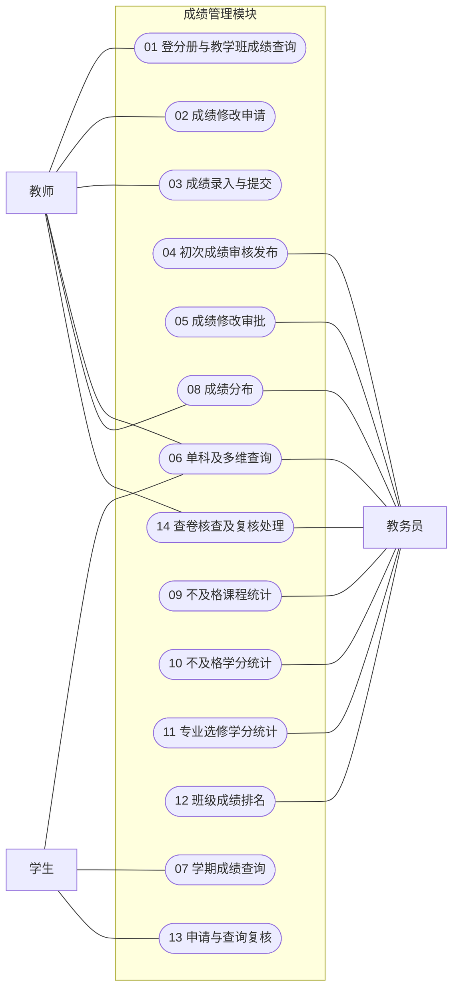
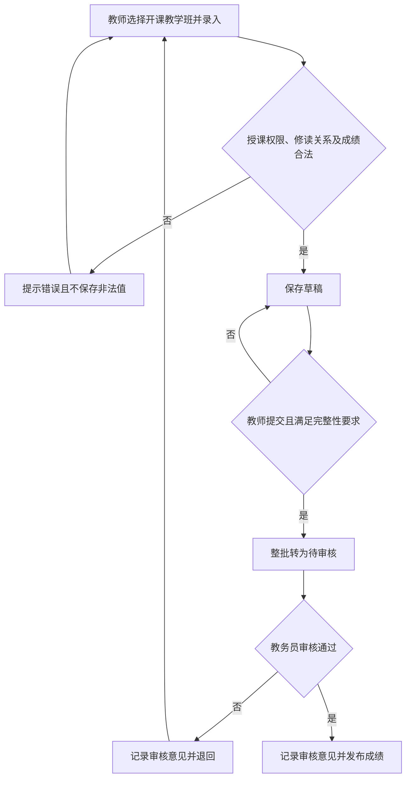
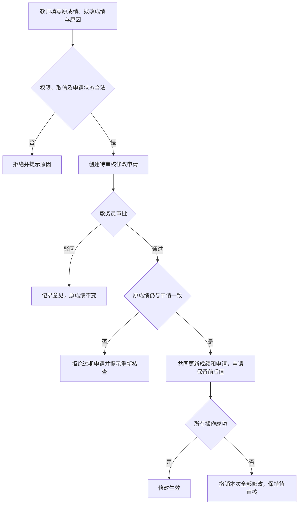
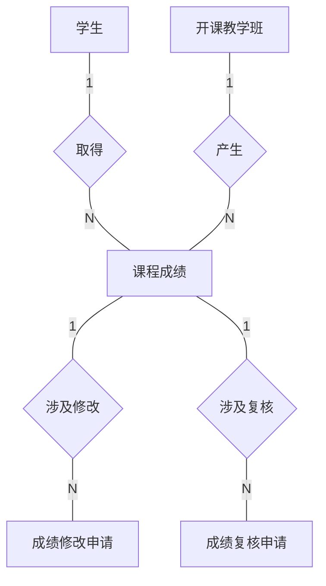

## 3.3 成绩管理模块

> 负责人：成员 B。阶段：需求分析。章节号暂定 3.3，合稿时由成员 E 统一调整。
> 编写依据：《分工与交付清单.md》《5人小组分工与需求分析模板.md》《教务系统需求分析2026.pdf》《教务系统-教师端功能说明.docx》《数据库测试业务.xlsx》。本文沿用全组公共实体名称，覆盖成绩管理的 9 条常规参考测试业务及 1 条可选事务失败测试业务。
> 本文是供小组评审的完整初稿。下文标为“拟定”的状态、计分和统计规则是本项目方案，不代表学校正式管理规定，合稿前需由小组确认。

### 3.3.1 模块业务概述与参与角色

- **业务边界**：负责课程成绩登分册、成绩录入与提交、成绩修改审批、查卷复核、多维成绩查询、成绩分布与排名、不及格课程及学分统计。毕业设计成绩由毕设模块负责；本模块提供课程学分统计结果供学籍模块毕业资格审查使用，不单独决定学生是否毕业。
- **外部数据依赖**：成员 A 提供学院、专业、班级、学生、教师、学期等公共信息，以及课程、开课教学班、选课关系和教师授课关系；成员 C 提供缓考等考试状态。A 的 `01_base` 中暂无教务员主表，`07_opt_rbac` 中的 `sys_user` 为后续选做脚本；成绩模块不另建同义学生、课程或教师实体，审核人工号暂按 A 的审批表口径保存，权限核验需在执行入口落实。
- **参与角色及职责**：
  - **教务员**：在授权范围内查询、审核和发布成绩，处理成绩修改与复核结论，进行成绩分布、排名、不及格及学分统计。
  - **教师**：查看本人承担教学班的登分册和成绩，录入并提交成绩，申请修改已发布成绩，核查学生复核申请，查看本人教学班的统计结果。
  - **学生**：查询本人已发布成绩，提交成绩复核申请，查询申请进度及处理结论。

**业务规则与统计口径（拟定，待小组确认）**

| 编号 | 规则 |
| :--- | :--- |
| BR-CJ-01 | 一条课程成绩对应一名学生对一个开课教学班的一次有效修读。同一课程不同学期或不同重修教学班的记录分别保留；同一次修读不重复建立成绩。补考多次考试的独立建模暂不在本初稿范围内，如纳入需另行细化。 |
| BR-CJ-02 | 基础范围采用百分制总评成绩，合法范围为 0–100，60 分及格。未录入不等于 0 分；缓考、缺考等单独标识，不自动换算为 0。分项计分、绩点换算需另行确认后加入。 |
| BR-CJ-03 | 成绩状态为“草稿、待审核、退回、已发布”。草稿和退回状态允许有权限的教师修改；待审核不得直接修改；审核通过即发布。学生只能查询已发布成绩。 |
| BR-CJ-04 | 开课教学班与教师允许多对多。查看权限来自授课关系；既有成绩直接编辑及修改申请权限还须核验本人为原录入教师。首次录入须由有授课权限的教师执行，重复录入不得覆盖他人记录。协同录入授权变更需由小组另定。 |
| BR-CJ-05 | 提交以教学班的一批成绩为范围。所有有效修读学生均须具有合法分数或经确认的特殊状态；特殊状态允许登记，但不进入数值成绩统计。提交、发布、修改审批应避免部分成功。 |
| BR-CJ-06 | 已发布成绩须经修改申请审批才能更改；申请保留原值、拟改值、原因、申请人、审批人及时间。审批时再次核对当前成绩与申请原值；发生变化则不批准过期申请。通过审批和更新成绩必须共同成功或共同撤销；已通过的修改申请本身就是变更历史。 |
| BR-CJ-07 | 成绩分布按已发布数值成绩分为 0–59、60–69、70–79、80–89、90–100 五档；小数分数按相应半开区间归档。比例分母为有效数值成绩人数，未录入及特殊状态人数另列，分母为零时显示暂无有效成绩。 |
| BR-CJ-08 | “某专业某年级所有不及格课程”按修读记录列出已发布且低于 60 分的成绩，并显示学期和教学班；重修通过不抹去历史不及格记录。 |
| BR-CJ-09 | “某学生不及格学分”拟按截至统计时点曾不及格、且尚无已发布及格记录的课程汇总，同一课程只计一次；课程学分按双方约定的培养方案口径取值。该口径与逐次累计历史不及格学分不同，需小组确认。 |
| BR-CJ-10 | “毕业年级已获专业选修课学分”以成员 A 提供的毕业年级学生范围为全集，筛选专业选修课程的已发布及格记录，同一学生同一课程只计一次。无已获学分者也显示，值为 0。课程类别、学分变更需保留适用口径，不得使历史统计无解释地变化。 |
| BR-CJ-11 | 班级排名拟按指定学期已发布数值成绩的学分加权平均分排序，同分同名次，采用 1、2、2、4 的并列规则。成绩不齐或存在待定考试状态者单独列示、不参加正式排名；无有效成绩不参与排名。 |
| BR-CJ-12 | 学生只可对本人成绩申请复核，同一成绩最多有一条未结束复核申请。复核不直接改分；需要更正时关联教师成绩修改申请，修改成功后才结束复核。复核申请开放时限由小组另行确定。 |

### 3.3.2 模块用例图

图 3.3-1 成绩管理模块用例图。下图以角色节点、椭圆用例和系统边界表示参与关系，属于 Mermaid 对用例图的表达；每个用例的输入输出见下一节。

教师参与本人授课范围内的业务，学生参与个人查询与复核；教务员负责授权范围内的审核与统计。角色关系不表示角色具有访问全部数据的权限。

### 3.3.3 核心用例说明表

| 用例编号 | 用例名称 | 参与者 | Input（输入数据） | Process（业务处理逻辑与校验规则） | Output（输出结果） |
| :--- | :--- | :--- | :--- | :--- | :--- |
| UC-CJ-01 | 成绩登分册与教学班成绩查询 | 教师 | 学期、开课教学班；教务查询可附教师条件 | 1. 验证授课关系。 2. 获取有效修读学生名单及对应成绩。 3. 未录入学生仍保留在名单中，成绩标注未录入。 | 合法：学号、姓名、教学班、成绩及状态列表。 非法：无授课权限或教学班不存在。 |
| UC-CJ-02 | 教师申请修改成绩 | 教师 | 成绩所属修读、拟改分数、修改原因 | 1. 校验本人授课及原录入人身份。 2. 校验分数范围、成绩已发布且无待审修改。 3. 保存原值与拟改值，创建待审核申请；正式成绩暂不变。 | 合法：申请编号、待审核状态。 非法：越权、分数非法、重复待审申请或状态不允许。 |
| UC-CJ-03 | 教师录入并提交成绩 | 教师 | 学期、开课教学班、学生成绩或特殊状态、保存或提交操作 | 1. 验证授课、原录入人权限和修读关系。 2. 校验分数 0–100，阻止重复成绩及非法状态覆盖。 3. 保存草稿；提交时校验名单完整性并将本批成绩统一转为待审核。 | 合法：草稿保存结果或提交结果。 非法：具体错误学生及原因；包括大于 100 分，失败不产生非法成绩。 |
| UC-CJ-04 | 初次成绩审核与发布 | 教务员 | 教学班、提交批次、审核结论、意见 | 1. 验证管理范围和待审核状态。 2. 核验名单及成绩。 3. 通过则统一发布；不通过则退回，并在课程成绩中记录审核结论、原因、审核人及时间。 | 合法：发布或退回结果。 非法：越权、批次失效或状态已改变。 |
| UC-CJ-05 | 成绩修改审批 | 教务员 | 修改申请、审核结论及意见 | 1. 校验授权、待审核状态和原成绩未变。 2. 驳回时只更新申请的结论和审批信息。 3. 通过时共同完成正式成绩更正与申请状态更新；任一步失败则全部撤销本次更改。已通过的申请保留变更前后值作为历史。 | 合法：修改生效或申请驳回。 非法：过期申请、非法分数、重复审批或执行失败；失败后原成绩及待审申请保持一致。 |
| UC-CJ-06 | 单科与多维成绩查询 | 学生、教师、教务员 | 学生、学期、课程、教学班；可按教师、班级、专业、年级筛选 | 1. 按身份限制数据范围，学生身份不可通过输入他人学号替代。 2. 关联学生、课程和开课教学班；同课程有多次修读时逐条列出，不随意合并。 3. 按可见状态返回。 | 合法：成绩、学期、课程、教学班及状态；无记录返回空结果。 非法：越权或无效查询条件。 |
| UC-CJ-07 | 学生学期成绩查询 | 学生 | 查询学期；当前学生身份 | 1. 获取本人该学期修读记录。 2. 展示已发布成绩及课程学分、性质。 3. 其他记录显示暂未发布，不泄露草稿数值。 | 合法：学期成绩单或暂无记录。 非法：身份失效或查询学期无效。 |
| UC-CJ-08 | 成绩分布统计 | 教师、教务员 | 学期、开课教学班，可附教师条件 | 1. 校验授课或管理权限。 2. 按 BR-CJ-07 统计有效成绩各档人数、占比与及格率。 3. 单独统计非数值状态，不因合讲教师关联而重复计算学生。 | 合法：各档人数与占比、有效人数、特殊状态人数。 非法：越权；无有效成绩时返回明确提示。 |
| UC-CJ-09 | 专业年级不及格课程统计 | 教务员 | 专业、年级、统计范围或学期 | 1. 验证管理范围。 2. 取得对应学生。 3. 按 BR-CJ-08 列出已发布不及格修读记录。 | 合法：学生、课程、学期、教学班、成绩及学分列表。 非法：越权或条件非法；无记录返回空列表。 |
| UC-CJ-10 | 学生不及格学分统计 | 教务员 | 学生、统计截止范围 | 1. 检查学生归属和授权。 2. 按 BR-CJ-09 去重课程并排除已通过课程。 3. 汇总学分。 | 合法：未通过课程明细及学分总数，无记录为 0。 非法：越权、学生不存在或课程学分缺失。 |
| UC-CJ-11 | 毕业年级专业选修学分统计 | 教务员 | 毕业年级或毕业批次、专业、统计截止范围 | 1. 从学籍模块取得目标学生全集。 2. 按 BR-CJ-10 筛选及格专业选修课程并按学生与课程去重。 3. 汇总每人学分，保留零学分学生。 | 合法：每名目标学生的已获专业选修学分和课程明细。 非法：越权或毕业范围、课程类别和学分信息缺失。 |
| UC-CJ-12 | 班级成绩排名 | 教务员 | 行政班级、学期 | 1. 校验管理范围。 2. 按 BR-CJ-11 检查成绩完整性并计算学分加权平均分。 3. 对有效学生排序，单独列出暂不参评者。 | 合法：平均分、名次、参评范围及未参评原因。 非法：越权或统计基础数据不完整。 |
| UC-CJ-13 | 申请及查询成绩复核 | 学生 | 本人成绩、复核原因；查询时提供申请或学期 | 1. 检查成绩属于本人且已发布。 2. 校验开放时限及无重复未结束申请。 3. 创建待核查申请；查询时只返回本人记录。 | 合法：申请编号、处理状态、结论及记录。 非法：越权、重复申请、超时或成绩未发布。 |
| UC-CJ-14 | 查卷核查及复核处理 | 教师、教务员 | 复核申请、核查说明、建议结果、审核意见 | 1. 核验教师授课或教务管理范围。 2. 教师核查并提交说明，交教务员确认。 3. 无需改分则办结；需改分则关联 UC-CJ-02/05，修改成功后办结，不直接绕过审批改分。 | 合法：核查记录、处理结论及相关修改申请。 非法：越权、重复处理或关联修改尚未成功；后者保持待处理状态。 |

**参考测试业务覆盖对照**

| 原表成绩模块项次 | 参考测试业务 | 对应用例与验证要求 |
| :--- | :--- | :--- |
| 1 | 查询某学生某学期某门课程成绩 | UC-CJ-06：按修读记录定位，避免重修混淆。 |
| 2 | 教师修改本人承担课程中某学生成绩 | UC-CJ-02、05：申请、审批后生效；草稿编辑由 UC-CJ-03 承担。 |
| 3 | 查询某教师某学期某课程的所有学生成绩 | UC-CJ-01、06：包含教学班维度，不因多教师授课重复结果。 |
| 4 | 学生查询某学期全部课程成绩 | UC-CJ-07：本人范围、发布可见规则。 |
| 5 | 为教师生成某课程成绩分布 | UC-CJ-08：分档边界、分母为零及特殊状态。 |
| 6 | 某专业某年级全部不及格课程 | UC-CJ-09：覆盖所有目标学生，列出历史修读明细。 |
| 7 | 某同学不及格学分总数 | UC-CJ-10：重复不及格课程去重、重修通过处理。 |
| 8 | 毕业年级每位同学已获专业选修学分 | UC-CJ-11：及格筛选、类别筛选、去重、零学分学生。 |
| 9 | 增加一条大于 100 分的成绩 | UC-CJ-03、05：录入与修改均拒绝；后续数据库测试须验证直接写入也无法绕过合法性约束。 |
| 10（可选） | 成绩修改审批过程中模拟事务失败 | UC-CJ-05：模拟更新成绩后、写历史前失败，验证本次审批所有改动撤销，无虚假成功记录。 |

### 3.3.4 核心业务流程图

**图 3.3-2 成绩录入、提交与发布流程**

**数据状态流转说明**：首次保存创建草稿成绩；提交将本批成绩转为待审核。退回后教师可修改并重新提交，通过后状态为已发布，学生才可读取数值。课程成绩保留最近一次审核人、时间及意见；如需保留每次退回的完整轨迹，应增加审核记录实体。

**图 3.3-3 已发布成绩修改与审批流程**

**数据状态流转说明**：提交申请只增加申请记录，正式成绩不变；驳回只改变申请状态。通过时成绩及带有前后值的申请共同生效，失败时全部恢复至本次审批前，支持可选回滚测试。

**复核与修改的衔接**：复核申请经历待核查、待确认、待更正、已办结等状态；无需更正时可从待确认直接办结。需更正时关联图 3.3-3 的修改申请与审批流程，复核本身不直接覆盖正式成绩，学生可查询核查与最终处理记录。具体输入和处理见 UC-CJ-13、UC-CJ-14。

### 3.3.5 本模块概念实体与联系（供合图用）

**去重原则**：学生、教师、课程、学期、开课教学班、选课及授课关系沿用全组公共模型，成绩模块不重新定义。修改申请已经保存修改前后值、审批结论与时间，因此兼作变更历史；复核申请记录教师核查和教务确认的结果，当前需求不要求逐次处理轨迹。初次审核的结论、审核人、时间放在课程成绩中。只有将来明确要求多轮审批逐次留痕时，才增加独立审核或处理记录实体。

1. **本模块新增实体与主要属性**：
   - **课程成绩**：总评成绩、考试状态、成绩状态、录入教师、录入时间、提交时间、审核结论、审核人、审核时间、发布时间。未录入与 0 分不同；一名学生在一次开课最多对应一条成绩。
   - **成绩修改申请**：修改前成绩、拟改成绩、原因、申请教师、申请时间、申请状态、审批人、审批意见、审批时间；已通过申请保留历史前后值。
   - **成绩复核申请**：申请学生、复核原因、申请时间、处理状态、教师核查意见与时间、教务确认意见与时间、最终结论；需要改分时可指向相关修改申请。
2. **引用的公共实体**：学生、教师、教务员、课程、学期、开课教学班，以及学生选修教学班、教师承担教学班的业务联系。学院、专业、班级和年级通过学生及公共组织关系获得。
3. **实体之间保留的联系**：

| 联系 | 基数与含义 |
| :--- | :--- |
| 学生—取得—课程成绩 | 1:N；一条成绩只属于一名学生。 |
| 开课教学班—产生—课程成绩 | 1:N；一条成绩只属于一个教学班，且学生必须有效修读该教学班。 |
| 课程成绩—涉及—成绩修改申请 | 1:N；可以保留多次申请，当前只允许一条待审批。 |
| 课程成绩—涉及—成绩复核申请 | 1:N；可以保留多次已办结复核，当前只允许一条未办结。 |

**图 3.3-4 成绩管理概念 E-R 子图**

图中矩形表示实体、菱形表示联系，数字表示基数。课程、学期、授课教师与教学班的联系，以及学生与教学班的选修联系已由课程模块表示，合并全局 E-R 图时直接引用。录入、审核、复核办理人员记录为相应业务实体的参与者属性，具体关联方式留待逻辑结构设计对齐公共人员表。

**合稿前需要确认的事项**

- 成员 A：确认毕业年级范围、组织归属、管理权限、有效选修关系、合讲教师列表，以及课程学分和类别的历史口径。
- 成员 C：确认缓考、缺考与成绩登记状态的对应关系。
- 成员 E：统一章节号，合并全局概念 E-R 图。
- 全组：确认初次成绩是否需要审核后发布、不及格学分口径、排名口径、复核申请时限；本稿按前文拟定方案保持内部一致。
