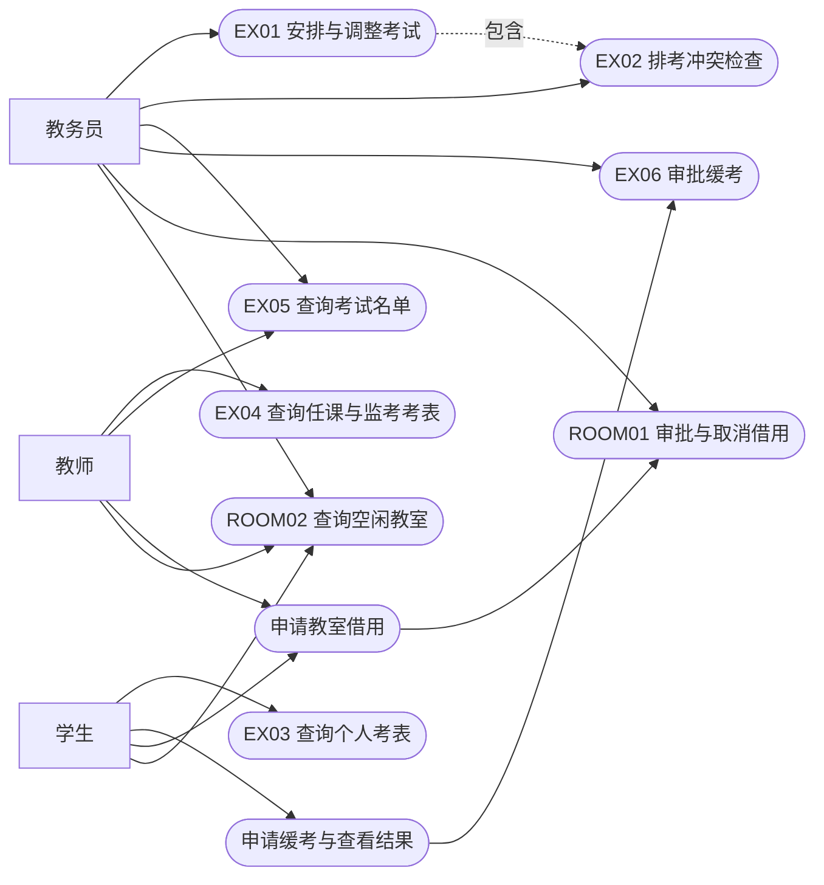
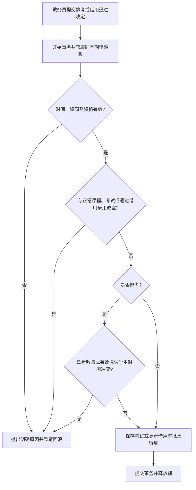
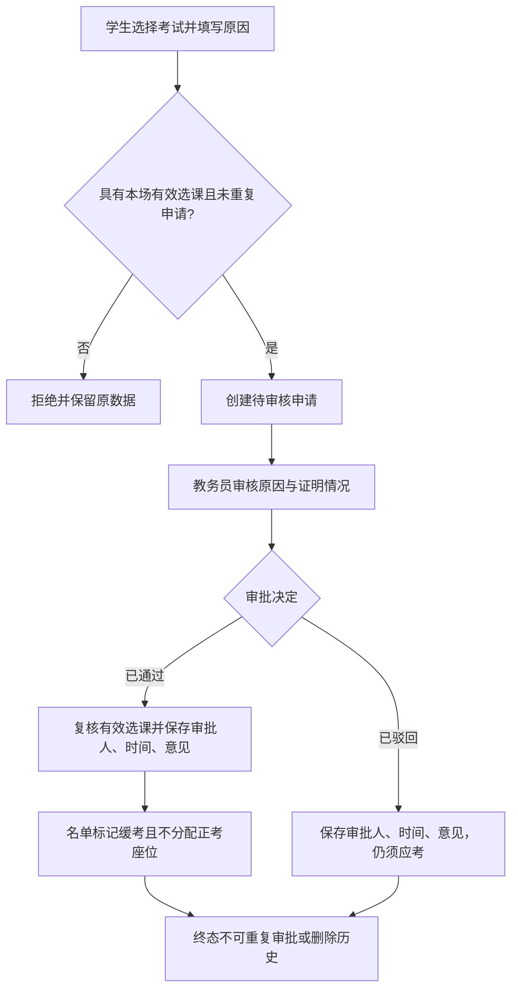
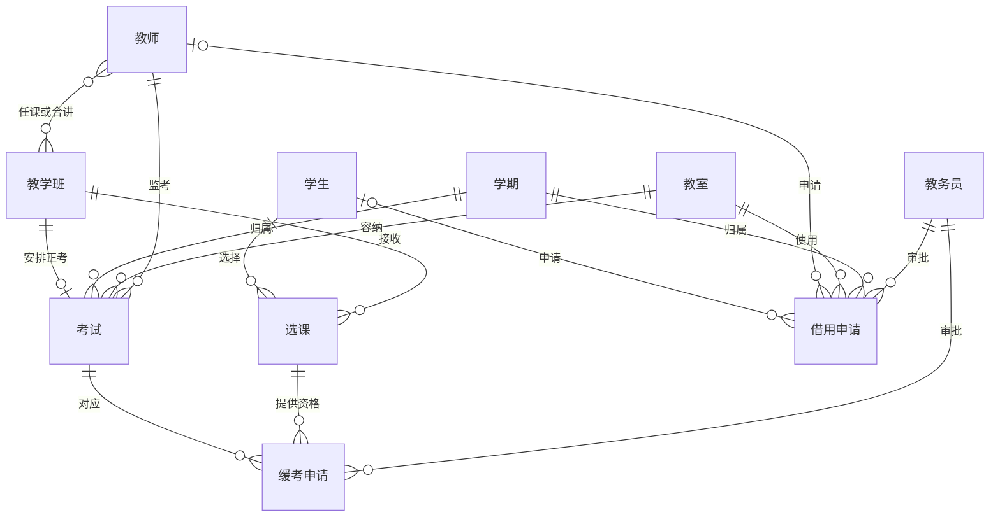

# 教务系统需求分析：考试管理、教室管理（成员 C）

成员 C 独立稿，供成员 E 合入阶段一文档。范围对应分工清单的 **考试 6 项、教室 2 项**。只实现数据库需求、设计、SQL 与验证，不开发前后端。

## 1. 模块边界与业务口径

复用 A 的学生、教师、学期、教室、课程、教学班、任课教师、排课与选课实体，不重复建公共主表。每个教学班安排一次正考，跨教学班合场、多监考教师、补考排期不在本次范围；缓考审批通过后保留资格记录，后续另行排期，不自动生成一场新考试。

时间使用“学期 + 周次 + 星期 + 节次”。考试是单次事件，等价于起止周相等、全周；借用允许周区间和单双周。节次区间闭合，1–2 节与 2–3 节冲突，1–2 节与 3–4 节不冲突。单双周以学期教学周编号判断，不按自然年周号判断。

学生名单来自状态为“已选”的真实选课记录，不能用教学班面向的行政班名单代替。待审及被驳回的缓考不影响应考；通过后在名单中标记“缓考”、不分配正考座位。为避免重新审批或改期造成冲突，排考时仍对全部有效选课学生预留时间及考位。

教室占用包含正常课程、考试、已通过借用。待审核、已驳回、已取消的借用不占用教室；审批通过前必须再次检查资源和冲突。空闲查询是查询时刻的结果，最终以审批事务中的校验为准。

## 2. 用例图

使用 Mermaid 表示三类角色与数据库业务用例。箭头表示角色参与用例，不表示表间引用。

## 3. 简化用例说明与验收映射

| 编号、名称 | 参与角色 | Input | Process | Output / 验收标准 |
| :--- | :--- | :--- | :--- | :--- |
| EX01 安排与调整考试 | 教务员 | 教学班、学期、教室、监考教师、教学周、星期、节次、考位、多媒体要求 | 核验教学班学期、时间范围、资源与冲突；整体提交或回滚 | 合法考试保存；每教学班正考不重复；非法改排保留原安排 |
| EX02 排考冲突检查 | 教务员 | 拟安排的考试 | 检查教室与课程/考试/借用；监考与监考/授课；有效选课学生与考试/课程；人数、设备、教室状态 | 返回明确冲突原因；失败不产生考试记录 |
| EX03 个人考表 | 学生 | 本人学号、学期 | 按有效选课关联考试与课程，附缓考状态，按周、星期、节次排序 | 包含课程、时间、地点、应考/缓考、座位；排除已退课 |
| EX04 教师考表 | 教师 | 本人工号、学期 | 合并任课（含合讲）与监考关系，按教师和考试去重 | 展示考试、时间、地点与两种角色标志；同场兼任只一行 |
| EX05 考试名单 | 教务员、对应任课教师 | 考试编号 | 关联真实有效选课，标记缓考，应考学生按学号编排座位 | 不漏跨班选修、不含已退课；缓考无正考座位，应考座号连续 |
| EX06 缓考申请与审批 | 学生、教务员 | 本人、考试、原因；审批决定、审批人、意见 | 核验本场有效选课，防重复申请；仅待审可终审；保存审批信息 | 待审→已通过/已驳回；通过同步影响名单；终态不得覆盖 |
| ROOM01 借用申请、审批与取消 | 学生、教师、教务员 | 唯一申请人、教室、时间、人数、设备、用途；审批或取消资料 | 提交校验申请资格及资源；通过时复查占用；取消释放占用并保存历史 | 待审→通过/驳回/取消，通过→取消；冲突审批保持待审；原审批记录保留 |
| ROOM02 空闲教室查询 | 三角色 | 学期、时间区间、人数、多媒体要求 | 排除不可用/容量不足/设备不符的教室，扣除三类实际重叠占用 | 返回满足整个申请区间的教室，按容量、编号排序；非法时间拒绝 |

“教务员审批人标识”和“查询本人”属于身份权限契约：由 A 的公共认证/RBAC 层绑定真实账号。本模块过程参数不等于登录认证，不接受将任意输入学号视作已实现行级权限隔离。

## 4. 核心业务流程

### 4.1 排考与借用审批的冲突检查

借用提交后可以等待教务员处理；待审期间资源可能改变，不能把提交时的空闲结果直接当作审批依据。

### 4.2 缓考审批状态流转

## 5. 概念 E-R 子图

下图仅表达业务概念与联系，不标注主外键、数据类型。学生、教师、学期、教学班、选课、教室为公共概念；考试、缓考申请、借用申请为本模块新增概念。

业务约束：每条借用申请的学生申请人与教师申请人有且仅有一个；教务员是公共身份角色，其身份关系由 A 的权限模块实现。本模块保留审批标识而不新建平行账号表。

## 6. 一致性与协作要求

采用 MySQL 8.0.16 及以上、InnoDB、utf8mb4 与组长指定排序规则，保证外键、检查约束和事务生效。审批不得只依赖说明文档，应由触发器和事务过程实施；查询名单避免暴露家庭、电话等无关个人字段。

C 只保证自身入口写入时相对于当时公共数据的冲突检查，不在 A 的表上附加触发器。合稿时须明确：排考之后再选退课、调课或修改教室容量，可能影响既有安排；全组运行顺序应为选课/排课稳定后排考，并在公共安排变更后重新校验。跨模块并发原子保护需要 A 共同采用统一资源锁协议，不能由 C 单方面修改公共结构完成。
